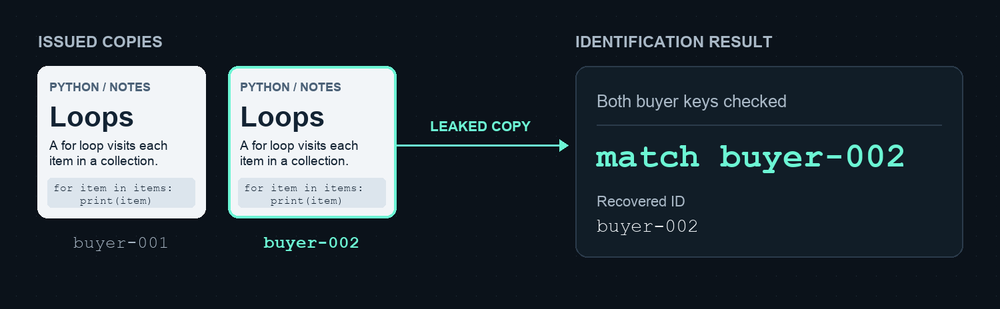
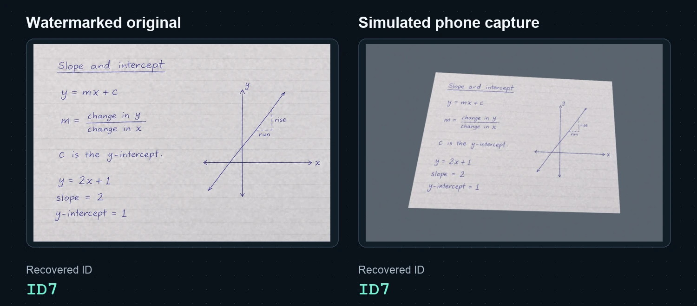

# TraceMark

**Same notes. Different fingerprints.**

Trace a leaked copy of text or an image back to the recipient it was issued to.



`pip install tracemark` · [Quick start](#quick-start) · [PyPI](https://pypi.org/project/tracemark/) · [GitHub](https://github.com/barebone-lab/tracemark) · [中文](https://github.com/barebone-lab/tracemark/blob/main/README.zh.md)

## Why TraceMark

In Hong Kong, DSE notes, tutoring materials and self-made revision notes circulate on second-hand platforms such as Carousell as PDFs, images and printed copies. A set of notes takes many hours to produce; copying a PDF costs nothing. When a buyer resells the file, uploads it to cloud storage or shares it with friends, the author loses not only one sale but also the pricing power and trust built around the material.

A visible watermark such as “For the use of XXX only” deters some buyers, but it can be cropped, covered, retyped after OCR, or lost in a reformatted screenshot. Once it is gone, the seller has nothing to follow. A visible watermark can deter; it cannot trace.

**TraceMark** gives every recipient a copy that looks the same but carries a different hidden fingerprint. When a copy leaks, it checks the copy against every recipient's key and answers one question: **who was this copy originally issued to?**

> **What it is:** post-hoc leak tracing for tutors, notes sellers and small content creators.  
> **What it is not:** DRM, encryption, or an automatic conviction tool. A match is a lead to check against transaction records, not a verdict.

## Install

```bash
pip install tracemark
```

TraceMark requires Python 3.10 or later. Installation from PyPI has been verified in a clean local Python 3.12 environment.

| Method | Command | Notes |
|---|---|---|
| PyPI | `pip install tracemark` | [Latest release on PyPI](https://pypi.org/project/tracemark/) |
| Local source | `git clone https://github.com/barebone-lab/tracemark.git`<br>`cd tracemark`<br>`python -m pip install .` | |
| Development mode | `python -m pip install -e .` | |
| Generative mode (optional) | `python -m pip install 'tracemark[generative]'` | Generation needs Apple silicon and MLX; downloads a model on first use |

Base dependencies are `numpy>=1.24`, `cryptography>=42`, `reedsolo>=1.7,<2` and `opencv-python-headless>=5.0.0.93`. The optional `generative` extra adds `mlx-lm>=0.31.3`.

## Quick start

Issue the same notes to two buyers, then check the leaked copy against both keys.

```python
from tracemark import embed, extract, identify

notes = (
    "Loops\nA for loop visits each item in a collection.\n"
    "for item in items:\n    print(item)"
)
keys = {"buyer-001": "demo-key-001", "buyer-002": "demo-key-002"}
copies = {
    buyer: embed(notes, buyer.encode(), key, mode="text_invisible")
    for buyer, key in keys.items()
}
leaked = copies["buyer-002"]
match = identify(leaked, keys, mode="text_invisible")
print(match.status, match.best)
print(extract(leaked, keys[match.best], mode="text_invisible").payload)
```

```text
match buyer-002
b'buyer-002'
```

## Image demo

`image_robust` recovered `ID7` from both images with `markers=False`. The simulated capture combines a steep perspective shift, 14° rotation, blur, glare, shadow, partial pen occlusion, and JPEG compression at quality 51. The panels show previews of the tested images.



## Why not existing tools

Each technique on its own has existing packages. What they do not offer is leak tracing: issuing one copy per person and naming the person behind a leaked copy, even after the copy has been degraded.

| Need | Existing packages | Where they stop | TraceMark |
|---|---|---|---|
| Find **who** leaked a copy | invisible-watermark, TrustMark, veilmark | Hide and read back bytes; no step that checks a copy against a list of recipients | `identify()` checks every recipient's key and returns `match`, `none` or `ambiguous`. For statistical (key-only) matches, the threshold rises with the number of keys so that the chance of naming anyone wrongly stays about 1 in 1,000 |
| Text that survives **retyping and OCR** | invisible-ink, veilmark, zero-width-lib, textwatermark | Hide marks in invisible or look-alike characters, which retyping, OCR or a one-line clean-up (e.g. dewatermark) removes | `text_lexical` carries the mark in ordinary word choices, so it survives retyping and a clean OCR round trip; key-only identification needs about 2,000 words |
| Images that survive a **phone photo of a screen** | invisible-watermark, TrustMark | invisible-watermark's README states its default methods are not robust to resizing or aspect-ratio-changing crops; we found no published test against phone photos of a screen | `image_robust` re-finds the tiled pattern after compression, cropping, rotation, screenshots and perspective; tested on simulated and real phone photos of a screen (see the demo above) |
| One interface for images and text | Separate tools with different APIs | — | The same `embed`, `extract` and `identify` for all five modes |

Comparisons are based on each package's public documentation, not on our own benchmarks of those packages.

## The five modes

| Mode | Carrier | Capacity | Robustness | Removed or broken by |
|---|---|---|---|---|
| `image_fragile` | Image | High (393,195 bytes @1024²) | Low | Compression, scaling, cropping, screenshots |
| `image_robust` | Image | Low (16–27 bytes, or key-only) | High | Heavy blur, very small or steep captures (markers help) |
| `text_invisible` | Text | Medium (64 bytes / 682 characters) | Low–medium | OCR, retyping, platform filtering |
| `text_lexical` | English text | Low (3 bytes in a 7,000-word sample, or key-only) | Medium | Rewriting, translation, misread or missing words |
| `text_generative` | Model-generated text | No payload (key-only) | Medium | Changing the model or decoding settings |

The modes are not mutually exclusive: a robust image watermark can carry a buyer number, invisible characters a transaction number, and a lexical watermark an extra text lead. Combined settings have not been evaluated yet.

### Fragile image mode (`image_fragile`)

**Principle:** payload bits are written into the least significant bit (LSB) of each pixel channel, so each value changes by at most a few levels. A key-derived pseudorandom permutation spreads the bits across the image; extraction reverses it with the same key. Each channel carries one or two bits; RGBA preserves alpha by default.

**Capacity:** for a 1024×1024 RGB image with the `standard` profile and one bit per channel, net capacity is **393,195 bytes** (after the 21-byte payload overhead).

**Robustness:** lossless formats and identical copies only; JPEG, scaling, cropping and screenshots destroy the payload.

**Purpose:** hides data and verifies that the extracted payload is intact. It does **not** localise tampering: there is no coordinate or heat map, and no integrity check of the whole image, so a successful extraction does not prove that the image is unmodified.

**References:** van Schyndel et al. (1994); Yeung & Mintzer (1997).

### Robust image mode (`image_robust`)

**Principle:** a key-dependent balanced pattern is added to image luminance and tiled across the picture. Pilot blocks provide synchronisation; autocorrelation and image outlines estimate rotation, scale and perspective. The payload uses a convolutional code, repetition and soft Viterbi decoding; when a payload is present, an authentication tag verifies it.

**Key-only:** with `payload=b''` the whole tile becomes one key-dependent pattern and is used for synchronisation, so fainter or more degraded copies can still be matched to a key.

**Markers:** `markers=False` by default, with no visible marks. `markers=True` adds eight ArUco markers at the four corners and four edge midpoints for harder captures; their visibility is set by `marker_strength`.

**Capacity:** the default marker-free compact layout holds up to **27 bytes**, or **16 bytes** with full rate-1/2 error correction. The marker layout holds **21/12 bytes**. Longer payloads use weaker error correction and are less robust.

**Limits:** the image's shorter side must be at least **400 px**. Success under cropping, rotation, compression and recapture depends on the image, the payload and the distortion; we report only measured cases and do not claim that any attack can be recovered.

**References:** Cox et al. (1997); Ge et al. (2023); Pramila et al. (2008).

### Invisible text mode (`text_invisible`)

**Principle:** U+200B represents 0, U+2060 represents 1, and U+2063 marks the boundary of each frame. Each inserted character carries one bit; insertion points are chosen at safe gaps so that combining characters and emoji are not split. The key protects the payload; it does not scramble insertion positions.

**Capacity:** the `standard` profile holds **64 bytes**; one copy adds `(64+21)*8+2 = 682` invisible characters.

**Robustness:** copy-paste usually preserves the characters; OCR, retyping and platform filtering remove them. NFC/NFKC normalisation alone is not the same as platform filtering; the example still extracted after normalisation.

**Ethics:** zero-width characters can also hide malicious instructions or bypass review. This project supports defensive use only and discloses the technique in its documentation.

**References:** Ishtiaq et al. (2025); Kaushik & Bhardwaj (2021).

### Lexical text mode (`text_lexical`)

**Principle:** the tokenizer and lexicon currently support English. Embedding needs approved substitution candidates: `candidates=` is a sequence of `Substitution(start, end, original, replacement)` with positions indexed into the original string, imported from `tracemark.text_lexical`. Alternatively, `provider=` supplies `propose(text)` to return candidates; the bundled `DeepSeekProvider` reads `DEEPSEEK_API_KEY`, sends sentences to DeepSeek and double-checks each substitution, so it involves an external API and the limits of automatic meaning review.

**Extraction:** only the text, the same public lexicon and the key are needed; it does not call an AI service or need the original document. Encoding uses anchors, local addresses, Reed–Solomon coding and equation solving.

**Capacity (measured on one sample, not a general guarantee):** a 7,000-word English sample can hide **3 bytes**; its 3,000-word prefix is not enough at the default setting. In key-only mode, a 2,000-word sample is enough to identify the source but not to hide the same 3-byte ID.

**Robustness:** the mark is in the words themselves, so it survives retyping and a clean OCR round trip as long as the words are read correctly. Rewriting, translation and misread or missing words can break it, and automatic review does not guarantee that meaning is unchanged. With `return_details=True`, embedding returns `(marked_text, details)`, including the substitutions made; by default it returns the marked text only.

**References:** Atallah et al. (2001); Lu et al. (2009); Stamatatos (2009).

### Generative text mode (`text_generative`)

**Principle:** a statistical watermark is added while a language model writes the text, so each recipient receives a different text that can be traced to their key. There is no payload (`payload=b''`). `model=` must provide a tokenizer, `decode`, `prompt_ids`, `logits` and `eos_ids`; the bundled `tracemark.text_generative.MLXModel` runs on Apple silicon and downloads a model on first use.

**Extraction and identification:** need only the text, the key and `tokenizer=`, which must match the one used for generation. Reading works on any platform; only generation needs Apple silicon. `verified=True` means the statistical threshold was met, not that a fixed payload was decoded.

**Positioning:** this mode watermarks text at generation time. It is not an AI-content detector, it does not decide whether a text was written by AI, and it does not claim compliance with Article 50 of the EU AI Act.

**References:** Kirchenbauer et al. (2023); Fernandez et al. (2023).

## API reference

```python
from tracemark import embed, extract, identify
```

`content` is text or an image, `payload` is `bytes`, and `key` is a non-empty `bytes` or `str`. Images are NumPy `uint8` arrays (RGB, RGBA or grayscale). `embed` returns a new image array or string and leaves the input unchanged. The API does not open or save files; file I/O is the caller's responsibility.

### Options per mode

| `mode` | `content` | Required data / options | Default profile |
|---|---|---|---|
| `image_fragile` | Image array | Non-empty `payload`; optional `bits_per_channel=1` or `2`, `use_alpha=False` | `standard` |
| `image_robust` | Image array | Short `payload` or `b''`; optional `strength=1.0`, `markers=False`, `marker_strength=0.4` | `compact` |
| `text_invisible` | Text | Non-empty `payload`; optional `copies=1` | `standard` |
| `text_lexical` | English text | `payload` or `b''`; exactly one of `provider=` or `candidates=` | `compact` |
| `text_generative` | Generation prompt | `payload=b''`, `model=`; optional `max_tokens=400`, `temperature=0.8`, `top_k=64`, `seed=` | No payload frame |

For `image_robust` and `text_lexical`, `payload=b''` means key-only: only a key-derived trace is left, a successful extraction returns `payload=b''`, and no separate hidden data can be recovered. Key-only `image_robust` requires `markers=False`.

### Return values and exceptions

- `ExtractResult`: `mode`, `verified`, `score`, `payload`, `details`.
- A wrong key or no watermark usually returns `verified=False`, `payload=None`, `score=0`; the reason is in `details`.
- `IdentifyResult`: `status`, `best`, `results`. `status` is `match` (exactly one key passes), `none` (all fail) or `ambiguous` (more than one key passes).
- `best` is the label with the highest score among passing candidates, or `None` if all fail. `results` maps each candidate label to its `ExtractResult` in candidate order; it is not a sorted list.
- Exceptions: `WatermarkError`, with subclasses `CapacityError` and `UnsupportedModeError`; invalid arguments may also raise `ValueError` or `TypeError`.

`score` is a within-mode evidence indicator, not a probability that a person leaked the file. When a payload is present, verification uses an authentication tag; for key-only and generative modes, `verified=True` means the statistical threshold was met.

## Current limitations

- Python API only; a CLI is planned.
- Images (any format that converts to a NumPy array, such as PNG or BMP) and text only; PDF, video and audio are not supported.
- A watermark is neither DRM nor encryption; an identification is a lead, not a verdict.
- `text_lexical` supports English text only.
- `text_generative` generation needs a model; the bundled MLX backend runs on Apple silicon only. It is not an AI-content detector.

## Test status

Local run on 20 November 2026 with Python 3.12.13: **82 passed, 2 skipped** in 140.80 s. Coverage has not been measured yet. Measured results and unverified design targets are listed separately in [03-testing-and-evaluation.md](https://github.com/barebone-lab/tracemark/blob/main/docs/03-testing-and-evaluation.md). **Unless a number is labelled as measured, it is a design target.**

## CS1302A project

TraceMark is the group project of group85 in CS1302A Introduction to Computer Programming (2026/27 Semester A).

| Member | GitHub | Main contributions |
|---|---|---|
| Wing | [@kittso](https://github.com/kittso) | Chinese documentation, `image_fragile` and its tests |
| Kay | [@okay9ks](https://github.com/okay9ks) | English documentation, `text_invisible` and its tests |
| Billy | [@barebone-lab](https://github.com/barebone-lab) | Package integration, `image_robust`, `text_lexical`, `text_generative`, tooling, packaging and release |
| Amos | [@Herm1tCrab](https://github.com/Herm1tCrab) | API tests, demo video |

Full roles, schedule and course mapping are in [04-project-and-course.md](https://github.com/barebone-lab/tracemark/blob/main/docs/04-project-and-course.md).

## Documentation

This README is available in English and [Chinese](https://github.com/barebone-lab/tracemark/blob/main/README.zh.md). The technical documents below are written in Traditional Chinese.

| Document | Content |
|---|---|
| [01-background.md](https://github.com/barebone-lab/tracemark/blob/main/docs/01-background.md) | Background and problem, two ideas, literature review, design goals, references, glossary |
| [02-architecture-and-api.md](https://github.com/barebone-lab/tracemark/blob/main/docs/02-architecture-and-api.md) | System architecture, public API, payload format, future work |
| [03-testing-and-evaluation.md](https://github.com/barebone-lab/tracemark/blob/main/docs/03-testing-and-evaluation.md) | What has been tested, attack matrix, evaluation metrics, targets still to verify |
| [04-project-and-course.md](https://github.com/barebone-lab/tracemark/blob/main/docs/04-project-and-course.md) | Team roles, schedule, milestones, risks, course mapping |
| [05-legal-ethics-and-appendix.md](https://github.com/barebone-lab/tracemark/blob/main/docs/05-legal-ethics-and-appendix.md) | Legal position, ethics, technical limits, AI-use statement, acknowledgements |
| [06-version-history.md](https://github.com/barebone-lab/tracemark/blob/main/docs/06-version-history.md) | Version history |

## Licence

Code: [MIT](https://github.com/barebone-lab/tracemark/blob/main/LICENSE). Documentation: CC BY 4.0 (planned).
