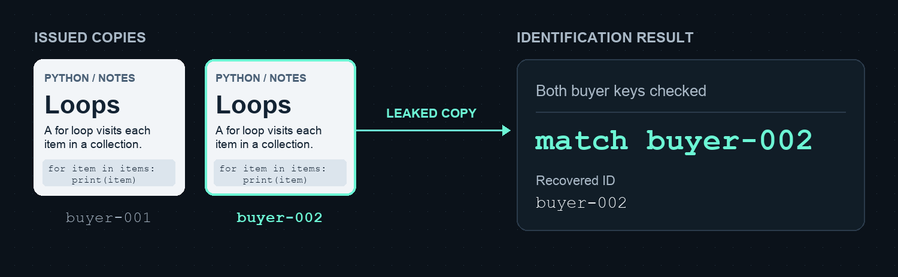
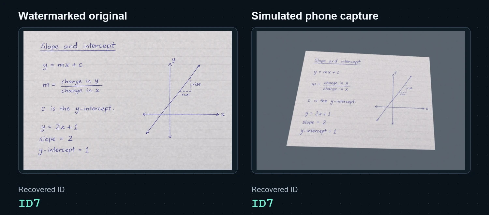

# TraceMark（溯印）

**同一份筆記，不同的指紋。**

把外洩的文字或圖片副本，追溯回當初收到它的人。



`pip install tracemark` · [快速開始](#快速開始) · [PyPI](https://pypi.org/project/tracemark/) · [GitHub](https://github.com/barebone-lab/tracemark) · [English](https://github.com/barebone-lab/tracemark/blob/main/README.md)

## 為甚麼需要 TraceMark

在香港，DSE 筆記、補習材料與自製溫習材料長期在 Carousell 等二手平台以 PDF、圖片或印刷本形式流通。一份筆記要花大量時間製作，複製一個 PDF 卻幾乎零成本。當買家把檔案轉售、上載到雲端或分享給朋友，原作者損失的不只是一次交易，還有定價能力與建立起來的信任。

「僅供 XXX 使用」這類可見浮水印能阻嚇部分買家，但可以被裁剪、遮蓋、經 OCR 重新輸入，或在截圖重新排版時消失。一旦被移除，賣家便無從追查。可見浮水印只能阻嚇，不能追溯。

**TraceMark** 讓每位收件人拿到看起來相同、但藏有不同指紋的副本。副本外洩時，它以每位收件人的密鑰逐一比對，回答一個問題：**這一份副本，原本是發給誰的？**

> **它是甚麼**：給補習導師、筆記賣家與小型內容創作者的事後外洩追溯工具。  
> **它不是甚麼**：不是 DRM、不是加密，也不是自動定罪工具。配對結果是要與交易紀錄互相印證的線索，不是判決。

## 安裝

```bash
pip install tracemark
```

TraceMark 需要 Python 3.10 或以上。已在全新的本機 Python 3.12 環境驗證 PyPI 安裝。

| 方式 | 指令 | 備註 |
|---|---|---|
| PyPI | `pip install tracemark` | [PyPI 最新版本](https://pypi.org/project/tracemark/) |
| 本地原始碼 | `git clone https://github.com/barebone-lab/tracemark.git`<br>`cd tracemark`<br>`python -m pip install .` | |
| 開發模式 | `python -m pip install -e .` | |
| 生成模式（可選） | `python -m pip install 'tracemark[generative]'` | 生成需要 Apple silicon 與 MLX；首次使用會下載模型 |

基礎依賴為 `numpy>=1.24`、`cryptography>=42`、`reedsolo>=1.7,<2` 與 `opencv-python-headless>=5.0.0.93`。可選的 `generative` 會另加 `mlx-lm>=0.31.3`。

## 快速開始

把同一份筆記發給兩位買家，再以兩把密鑰比對外洩的副本。

```python
from tracemark import embed, extract, identify

notes = (
    "Loops\nA for loop visits each item in a collection.\n"
    "for item in items:\n    print(item)"
)
keys = {"buyer-001": "demo-key-001", "buyer-002": "demo-key-002"}
copies = {
    buyer: embed(notes, buyer.encode(), key, mode="text_invisible")
    for buyer, key in keys.items()
}
leaked = copies["buyer-002"]
match = identify(leaked, keys, mode="text_invisible")
print(match.status, match.best)
print(extract(leaked, keys[match.best], mode="text_invisible").payload)
```

```text
match buyer-002
b'buyer-002'
```

## 圖片示範

`image_robust` 在 `markers=False` 下，從兩張圖都還原出 `ID7`。模擬拍攝同時包含大角度透視、14° 旋轉、模糊、反光、陰影、筆身部分遮擋，以及品質 51 的 JPEG 壓縮。圖中為測試圖片的預覽。



## 為甚麼不用現有工具

每種技術單獨來看都已有現成套件，但它們都沒有提供外洩追溯：為每人發一份副本，並在副本被破壞後仍能指出外洩者。

| 需求 | 現有套件 | 不足之處 | TraceMark |
|---|---|---|---|
| 找出**誰**外洩副本 | invisible-watermark、TrustMark、veilmark | 只能藏入及讀回資料，沒有以收件人名單比對副本的步驟 | `identify()` 逐一以收件人的密鑰比對，回傳 `match`、`none` 或 `ambiguous`。統計（key-only）比對的門檻會隨密鑰數量提高，令誤認任何人的機會維持在約千分之一 |
| 文字能抵抗**重新打字與 OCR** | invisible-ink、veilmark、zero-width-lib、textwatermark | 把標記藏在不可見或形近字元中，重新打字、OCR 或一行清理（例如 dewatermark）就會移除 | `text_lexical` 把標記放在普通的用字選擇中，因此能抵抗重新打字與乾淨的 OCR 往返；key-only 識別約需 2,000 字 |
| 圖片能抵抗**手機翻拍螢幕** | invisible-watermark、TrustMark | invisible-watermark 的 README 表明其預設方法不能抵抗縮放及改變長寬比的裁剪；我們找不到針對手機翻拍螢幕的公開測試 | `image_robust` 能在壓縮、裁剪、旋轉、截圖與透視變形後重新找回平鋪圖案；已用模擬及真實的手機翻拍螢幕測試（見上方示範） |
| 圖片與文字共用一套介面 | 各自獨立、API 各異的工具 | — | 五種模式共用 `embed`、`extract`、`identify` |

以上比較根據各套件的公開文件，並非我們對這些套件的實測。

## 五種模式

| 模式 | 載體 | 容量 | 穩健性 | 會被甚麼移除或破壞 |
|---|---|---|---|---|
| `image_fragile` | 圖像 | 高（393,195 bytes @1024²） | 低 | 壓縮、縮放、裁剪、截圖 |
| `image_robust` | 圖像 | 低（16–27 bytes，或 key-only） | 高 | 嚴重模糊、拍得很小或角度很斜（可用標記改善） |
| `text_invisible` | 文字 | 中（64 bytes／682 字元） | 低—中 | OCR、重新打字、平台過濾 |
| `text_lexical` | 英文文字 | 低（7,000 字樣本 3 bytes，或 key-only） | 中 | 改寫、翻譯、錯讀或漏掉字詞 |
| `text_generative` | 模型生成文字 | 無載荷（key-only） | 中 | 更換模型或解碼設定 |

五種模式不是互斥的：可以穩健圖像水印承載買家編號、以零寬字元承載交易序號，再以選詞水印提供額外的文字線索。組合設定尚未評估。

### 圖像脆弱模式（`image_fragile`）

**原理**：把載荷位元寫入每個像素通道的最低有效位元（LSB），每個數值最多只改動幾級。以密鑰派生的偽隨機置換把位元分散到整幅圖；提取時以同一密鑰還原。每個通道可承載 1 或 2 bits；RGBA 預設保留 alpha。

**容量**：1024×1024 RGB、`standard` profile、每通道 1 bit 時，淨容量為 **393,195 bytes**（已扣除 21-byte 載荷開銷）。

**穩健性**：只適用於無損格式與完全相同的副本；JPEG、縮放、裁剪與截圖都會破壞載荷。

**用途**：隱藏資料，並驗證提取出的載荷完整無誤。**不提供竄改定位**：沒有座標或熱圖，也沒有對整幅圖像作完整性檢查，因此成功提取不代表圖像未被修改。

**文獻**：van Schyndel et al. (1994); Yeung & Mintzer (1997)。

### 圖像穩健模式（`image_robust`）

**原理**：在圖像亮度中加入由密鑰決定的平衡圖案，並平鋪到整幅圖。pilot 區塊負責同步；以自相關與圖像輪廓估計旋轉、縮放與透視。載荷使用卷積碼、重複與 soft Viterbi 解碼；有載荷時以認證標籤驗證。

**Key-only**：`payload=b''` 時，整個圖塊變成一個由密鑰決定的圖案並全部用於同步，因此更淡或破壞更嚴重的副本仍能配對到密鑰。

**標記**：預設 `markers=False`，沒有任何可見標記。`markers=True` 會在四角及四邊中點加入八個 ArUco 標記，應付較困難的拍攝；可見程度由 `marker_strength` 控制。

**容量**：預設無標記 compact 布局最多 **27 bytes**，採完整 rate-1/2 糾錯時為 **16 bytes**。標記布局為 **21／12 bytes**。載荷越長，糾錯越弱，穩健性亦越低。

**限制**：圖片短邊至少要 **400 px**。裁剪、旋轉、壓縮與翻拍能否成功，取決於圖像、載荷與失真程度；我們只報告已測案例，不宣稱任何攻擊都能還原。

**文獻**：Cox et al. (1997); Ge et al. (2023); Pramila et al. (2008)。

### 文字零寬模式（`text_invisible`）

**原理**：U+200B 表示 0，U+2060 表示 1，U+2063 標示每個 frame 的邊界。每個插入的字元承載 1 bit；插入點選在安全的文字間隙，避免拆開組合字元與 emoji。密鑰用於保護載荷，並不打亂插入位置。

**容量**：`standard` profile 可藏 **64 bytes**；每份副本新增 `(64+21)*8+2 = 682` 個不可見字元。

**穩健性**：複製貼上通常會保留這些字元；OCR、重新打字與平台過濾會把它們移除。NFC／NFKC 正規化本身不等同平台過濾；範例在正規化後仍能提取。

**倫理**：零寬字元也可被用來隱藏惡意指令或繞過審查。本專案只支援防禦性用途，並在文件中公開技術原理。

**文獻**：Ishtiaq et al. (2025); Kaushik & Bhardwaj (2021)。

### 文字選詞模式（`text_lexical`）

**原理**：目前的 tokenizer 與詞表支援英文。嵌入需要已批准的替換候選：`candidates=` 是 `Substitution(start, end, original, replacement)` 的序列，位置是原文字串的索引，類別從 `tracemark.text_lexical` 匯入。另一選項是 `provider=`，提供 `propose(text)` 回傳候選；內建的 `DeepSeekProvider` 讀取 `DEEPSEEK_API_KEY`，把句子送到 DeepSeek 並逐一複核替換，因此涉及外部 API 與自動文意審查的限制。

**提取**：只需文字、相同的公開詞表與密鑰；不會呼叫 AI 服務，也不需要原文。編碼使用錨點、局部位址、Reed–Solomon 與方程求解。

**容量（單一樣本的實測結果，不是通用保證）**：7,000 字的英文樣本可藏 **3 bytes**；其前 3,000 字在預設設定下不足。key-only 模式下，2,000 字的樣本足以辨認來源，但不足以藏同一個 3-byte ID。

**穩健性**：標記就在字詞本身，只要字詞被正確讀出，就能抵抗重新打字與乾淨的 OCR 往返。改寫、翻譯、錯讀或漏掉字詞可能令其失效，而自動審查亦不保證文意完全不變。`return_details=True` 時，嵌入回傳 `(marked_text, details)`，包含實際替換紀錄；預設只回傳加了水印的文字。

**文獻**：Atallah et al. (2001); Lu et al. (2009); Stamatatos (2009)。

### 文字生成模式（`text_generative`）

**原理**：在語言模型撰寫文字時加入統計水印，讓每位收件人收到一篇不同、並可追溯到其密鑰的文字。此模式沒有載荷（`payload=b''`）。`model=` 必須提供 tokenizer、`decode`、`prompt_ids`、`logits` 與 `eos_ids`；內建的 `tracemark.text_generative.MLXModel` 在 Apple silicon 上執行，首次使用會下載模型。

**提取與識別**：只需文字、密鑰與 `tokenizer=`，且 tokenizer 須與生成時相同。讀取可在任何平台進行，只有生成需要 Apple silicon。`verified=True` 表示通過統計門檻，而不是解出一段固定載荷。

**定位**：此模式在生成時為文字加水印。它不是 AI 生成內容偵測器，不判斷一段文字是否由 AI 撰寫，也不宣稱符合 EU AI Act 第 50 條。

**文獻**：Kirchenbauer et al. (2023); Fernandez et al. (2023)。

## API 參考

```python
from tracemark import embed, extract, identify
```

`content` 是文字或圖片，`payload` 是 `bytes`，`key` 是非空的 `bytes` 或 `str`。圖片是 NumPy `uint8` 陣列（RGB、RGBA 或灰階）。`embed` 回傳新的圖片陣列或字串，原輸入不變。API 不開檔、不存檔，檔案讀寫由呼叫者負責。

### 各模式選項

| `mode` | `content` | 所需資料／選項 | 預設 profile |
|---|---|---|---|
| `image_fragile` | 圖片陣列 | 非空 `payload`；可選 `bits_per_channel=1` 或 `2`、`use_alpha=False` | `standard` |
| `image_robust` | 圖片陣列 | 短 `payload` 或 `b''`；可選 `strength=1.0`、`markers=False`、`marker_strength=0.4` | `compact` |
| `text_invisible` | 文字 | 非空 `payload`；可選 `copies=1` | `standard` |
| `text_lexical` | 英文文字 | `payload` 或 `b''`；`provider=` 與 `candidates=` 必須恰好提供一個 | `compact` |
| `text_generative` | 生成提示文字 | `payload=b''`、`model=`；可選 `max_tokens=400`、`temperature=0.8`、`top_k=64`、`seed=` | 不使用載荷 frame |

`image_robust` 與 `text_lexical` 的 `payload=b''` 代表 key-only：只留下由密鑰派生的痕跡，提取成功時回傳 `payload=b''`，不能還原另一段隱藏資料。`image_robust` 的 key-only 要求 `markers=False`。

### 回傳值與例外

- `ExtractResult`：`mode`、`verified`、`score`、`payload`、`details`。
- 錯密鑰或沒有水印時，通常回傳 `verified=False`、`payload=None`、`score=0`；原因在 `details`。
- `IdentifyResult`：`status`、`best`、`results`。`status` 為 `match`（恰好一個密鑰通過）、`none`（全部不通過）或 `ambiguous`（多於一個密鑰通過）。
- `best` 是通過者中分數最高的標籤，全部不通過時為 `None`。`results` 按候選順序把每個標籤對應到其 `ExtractResult`，不是排序列表。
- 例外：`WatermarkError`，以及其子類 `CapacityError`、`UnsupportedModeError`；不合法的參數亦可能引發 `ValueError` 或 `TypeError`。

`score` 是模式內的證據指標，不是某人外洩檔案的機率。有載荷時以認證標籤驗證；key-only 與生成模式的 `verified=True` 表示通過統計門檻。

## 目前限制

- 只提供 Python API；CLI 仍在規劃中。
- 只支援圖像（任何可轉為 NumPy 陣列的格式，例如 PNG、BMP）與文字；不支援 PDF、影片與音訊。
- 水印不是 DRM，也不是加密；識別結果是線索，不是判決。
- `text_lexical` 只支援英文文字。
- `text_generative` 的生成需要模型；內建的 MLX backend 只能在 Apple silicon 上執行。它不是 AI 生成內容偵測器。

## 測試狀態

2026 年 11 月 20 日以 Python 3.12.13 在本機測試：**82 項通過、2 項跳過**，耗時 140.80 秒。測試覆蓋率尚未量測。已測結果與未驗證的設計目標分開列於 [03-testing-and-evaluation.md](https://github.com/barebone-lab/tracemark/blob/main/docs/03-testing-and-evaluation.md)。**除非標明為實測，所有數字都是設計目標。**

## CS1302A 專案

TraceMark 是 CS1302A Introduction to Computer Programming（2026/27 Semester A）group85 的小組專案。

| 成員 | GitHub | 主要貢獻 |
|---|---|---|
| Wing | [@kittso](https://github.com/kittso) | 中文文件、`image_fragile` 及其測試 |
| Kay | [@okay9ks](https://github.com/okay9ks) | 英文文件、`text_invisible` 及其測試 |
| Billy | [@barebone-lab](https://github.com/barebone-lab) | 套件整合、`image_robust`、`text_lexical`、`text_generative`、工具、打包與發布 |
| Amos | [@Herm1tCrab](https://github.com/Herm1tCrab) | API 測試、示範影片 |

完整分工、時程與課程對應見 [04-project-and-course.md](https://github.com/barebone-lab/tracemark/blob/main/docs/04-project-and-course.md)。

## 文件

本 README 有[英文版](https://github.com/barebone-lab/tracemark/blob/main/README.md)與中文版。以下技術文件以繁體中文撰寫。

| 文件 | 內容 |
|---|---|
| [01-background.md](https://github.com/barebone-lab/tracemark/blob/main/docs/01-background.md) | 背景與問題、兩個構思、文獻回顧、設計目標、參考文獻、名詞表 |
| [02-architecture-and-api.md](https://github.com/barebone-lab/tracemark/blob/main/docs/02-architecture-and-api.md) | 系統架構、公開 API、載荷格式、未來工作 |
| [03-testing-and-evaluation.md](https://github.com/barebone-lab/tracemark/blob/main/docs/03-testing-and-evaluation.md) | 已測範圍、攻擊矩陣、評估指標、待驗證目標 |
| [04-project-and-course.md](https://github.com/barebone-lab/tracemark/blob/main/docs/04-project-and-course.md) | 團隊分工、時程、里程碑、風險、課程對應 |
| [05-legal-ethics-and-appendix.md](https://github.com/barebone-lab/tracemark/blob/main/docs/05-legal-ethics-and-appendix.md) | 法律定位、倫理原則、技術限制、AI 使用聲明、致謝 |
| [06-version-history.md](https://github.com/barebone-lab/tracemark/blob/main/docs/06-version-history.md) | 版本紀錄 |

## 授權

程式碼：[MIT](https://github.com/barebone-lab/tracemark/blob/main/LICENSE)。文件：CC BY 4.0（預定）。
