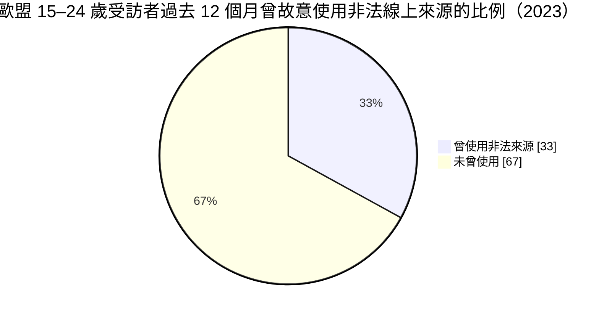
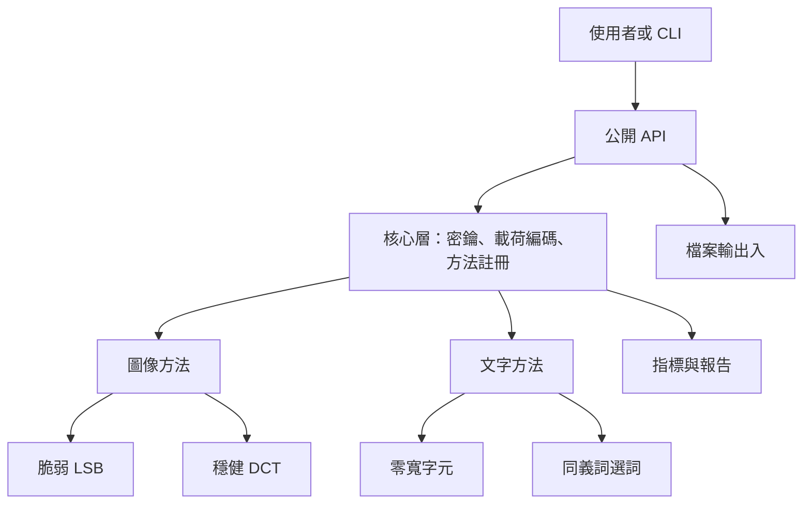
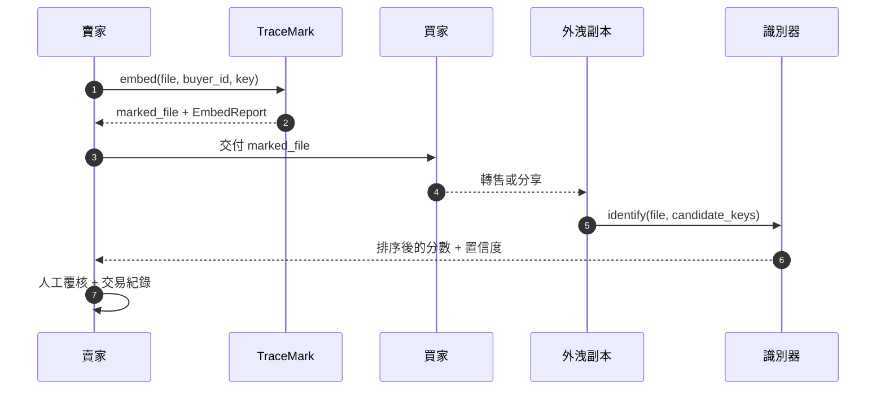
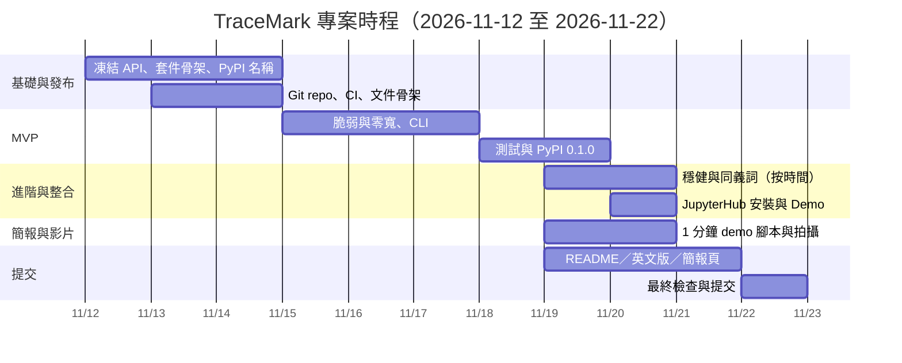
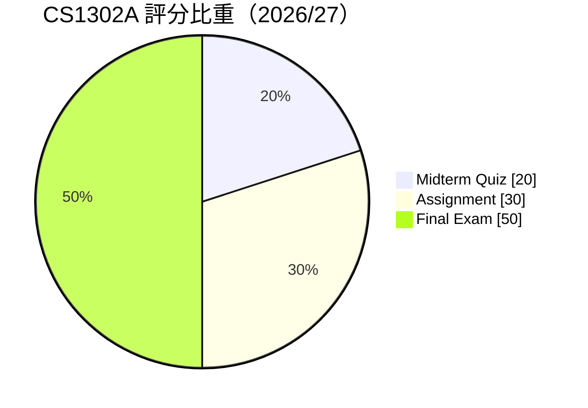

# TraceMark（溯印）

> **已歸檔（v0.2）**：此檔是 2026-11-12 的歷史備份，內容已過時；最新文件請看 [README.md](README.md) 與 [README.zh.md](README.zh.md)。

> 讓每一份售出的筆記，都帶有一個看不見、但追得回的簽名。

**CS1302A 專案文件 · Project Documentation**

**TraceMark** 是一個以 Python 編寫的數碼水印與外洩溯源模組，為補習導師、筆記賣家與小型內容創作者而設。它不能阻止別人複製檔案，但當檔案被轉售或外洩時，它能回答一個關鍵問題：**這一份副本，原本是交給誰的？**

| 項目 | 內容 |
|---|---|
| 課程 | CS1302A Introduction to Computer Programming（2026/27 Semester A） |
| 團隊 | 4 人（group85）：文件 ×2、程式 ×1、影片 ×1 |
| 截止 | 2026-11-22（星期日）23:59 |
| 文件版本 | v0.2（2026-11-12） |
| 實作狀態 | 設計與文獻回顧完成；程式進行中（Billy） |
| 測試狀態 | 尚未實測；本文所有效能數字均為設計目標；JupyterHub 安裝與 demo 待完成 |
| 授權 | 程式碼 MIT（預定）；文件 CC BY 4.0（預定） |

> **一句話**：TraceMark 為每份售出的教材嵌入看不見的買家識別碼，並在外洩後以候選密鑰比對，輸出可解釋的相似度分數。  
> **不是什麼**：不是 DRM、不是加密、不是自動定罪工具。  
> **現況**：設計與文獻完成；程式與實測進行中。

---

## 目錄

1. 摘要
2. 背景與問題
3. 兩個構思與選擇
4. 文獻回顧
5. 設計目標與範圍
6. 系統架構
7. 四種水印方法
8. 公開 API
9. 測試與評估
10. 專案管理
11. 課程對應（CS1302A）
12. 法律、倫理與限制
13. 未來工作
14. 參考文獻
15. 附錄

---

## 1. 摘要

在香港，DSE 筆記、補習講義與自製溫習材料長期在 Carousell 等二手平台以 PDF、圖片或印刷本形式流通。一份筆記的製作成本以大量時間計，複製一個 PDF 的成本卻接近零。當買家將同一份檔案轉售、上載到雲端或分享給朋友，原作者損失的不只是單次交易收入，還有隨之而來的價格競爭與品牌信任。

傳統做法是在 PDF 上印上「僅供 XXX 使用」的可見浮水印。這種方法有阻嚇作用，但買家可以裁剪、遮蓋、以 OCR 重新輸入，或直接截圖後再排版；一旦可見標記被移除，賣家便失去追溯線索。換言之，傳統水印只能「阻嚇」，卻無法在事後「追溯」。

**TraceMark（溯印）** 正是針對這個缺口而設計。它為每一位買家嵌入一組獨立的識別碼，並在文件外洩時，以候選密鑰比對內容，輸出「最可能的外洩版本」與相似度分數。模組提供四種互補方法：

1. **圖像脆弱水印**：改動最低有效位元（LSB），容量大、不可見，但只適合完整性驗證與原檔追蹤。
2. **圖像穩健水印**：在離散餘弦變換（DCT）係數中分散嵌入、重複編碼，並加入同步標記，目標是抵抗 JPEG 壓縮、裁切與截圖。
3. **文字零寬字元水印**：利用 U+200B、U+200C、U+200D、U+FEFF 等不可見字元編碼，可隨複製貼上移動。
4. **文字同義詞選詞水印**：由密鑰決定同義詞的選擇，將訊號藏於用字之中，對人手重新輸入具部分穩健性。

四種方法共用同一套 `embed`、`extract`、`identify` 介面；識別功能可一次比對多個候選密鑰，並回傳排序後的分數。TraceMark 的定位不是 DRM，也不是加密工具，而是**事後追溯**：它不能阻止複製，但能在外洩發生後，為賣家提供可與交易紀錄互相印證的技術線索。

本文件說明問題背景、兩個構思的取捨、相關文獻、系統設計、測試計畫、課程對應與限制。**目前程式仍在實作階段，本文所有效能數字均為設計目標，並非實測結果。**

---

## 2. 背景與問題

### 2.1 本地情境：筆記作為可複製的數碼商品

在香港，補習筆記與自製教材在二手平台流通，並非新現象。賣家花費大量時間整理課堂內容、自製例題與溫習材料，再以付費形式出售；買家購入後，可以輕易將同一份 PDF 轉售、上載或分享。與實體書不同，數碼檔案的複製不會造成品質衰減，也幾乎沒有邊際成本，因此「二次販賣」對原作者的傷害特別直接。

這類交易還有一個結構性問題：買賣雙方往往只有一對一的通訊紀錄，檔案一旦離開賣家的裝置，便失去與買家之間的技術連結。當賣家在另一個平台發現自己的筆記被低價轉售，他可能認得內容，卻無法證明「這一份副本最初是交給誰」。沒有這個連結，平台檢舉與法律追究都缺少關鍵證據。

### 2.2 侵權與執法現況

香港海關的執法案例說明，補習筆記與教材並非邊緣地帶，而是實際的侵權商品類別。

**表 1：香港海關涉及補習／教材侵權的行動**

| 日期 | 案件 | 行動與檢獲 | 與本專案的關聯 |
|---|---|---|---|
| 2016-11-23/24 | 連鎖補習社分發侵權補習筆記 | 檢獲逾 50,000 頁侵權筆記、25 部電腦、1 部打印機、13 部影印機，估計市值約 HK\$580,000；14 人被捕 | 補習筆記本身是侵權高風險商品 |
| 2026-03-10/11 | 網上售賣盜版中小學教材 | 2 名女子（29 歲及 54 歲）被捕；賣家收取款項後，以即時通訊應用程式傳送電子檔案 | 數碼教材複製成本低、傳播快，事後追溯困難 |

2016 年一案涉及逾五萬頁補習筆記，檢獲物品估計市值約 HK\$580,000；2026 年一案則顯示，侵權教材已改以電子檔案經即時通訊交付。前者說明侵權規模可以很大，後者說明數碼交付令複製與散播更快、更難追蹤。根據《版權條例》，未經版權擁有人特許而銷售或為售賣用途管有侵權物品，最高可判監禁四年，並可就每件侵權物品罰款 HK\$50,000（Hong Kong Customs and Excise Department, 2016, 2026）。

### 2.3 問題規模的間接證據

如果侵權是普遍現象，為何賣家仍難以追究？其中一個原因是，買家與賣家之間的交易往往只有一對一的通訊紀錄；另一個原因是，年輕族群對數碼內容的取得與分享態度較為開放。

歐盟知識產權局（European Union Intellectual Property Office [EUIPO], 2023）在 2023 年 1 月 30 日至 2 月 15 日期間，以線上方式訪問了 25,824 名 15 歲以上的歐盟居民。結果顯示，14% 受訪者承認在過去 12 個月曾故意使用非法線上來源；在 15–24 歲組別，比例升至 33%，是歐盟平均的兩倍以上。



*資料來源：EUIPO（2023），第 48 頁；樣本為 25,824 名 15 歲以上歐盟居民，15–24 歲為其中一個子組別。*

同一調查亦顯示，年輕族群在多種未經授權行為上的比例都高於平均：

**表 2：歐盟平均與 15–24 歲組別的比較（過去 12 個月）**

| 行為 | 歐盟平均 | 15–24 歲 | 倍數 |
|---|---:|---:|---:|
| 故意使用非法線上來源 | 14% | 33% | 2.4× |
| 非法串流體育內容 | 12% | 27% | 2.3× |
| 使用非法串流裝置 | 11% | 25% | 2.3× |
| 上載受版權保護內容與他人分享 | 11% | 25% | 2.3× |

*資料來源：EUIPO（2023），第 13–15、48–52 頁。*

此外，39% 受訪者曾懷疑自己買到的商品是否正品，15–24 歲組別升至 52%；15% 受訪者表示曾在不知情下買到仿冒品，15–24 歲組別為 23%。另有 13% 受訪者承認曾故意購買仿冒品，15–24 歲組別為 26%（EUIPO, 2023）。這些數字與本專案的情境有相似之處：買家未必意識到自己正在購買或轉售侵權副本，而賣家則需要一種能在事後辨認來源的工具。

> **重要限制**：以上是歐盟數據，並非香港數據；它不能用來推斷香港的實際比例。本文引用它，是為了說明一個跨地區的模式：年輕、熟悉數碼工具的族群，同時也是未經授權分享行為的高風險群體。香港目前缺乏針對「筆記轉售」的代表性調查，這是本研究的一項限制，也是未來工作之一。

### 2.4 現有做法為何不足

- **可見浮水印**：只能阻嚇，移除成本低；買家可以裁剪、遮蓋、重新輸入或截圖後再排版。
- **PDF 密碼與 DRM**：限制開啟或列印，但截圖、拍照、OCR 後即失效；部署與維護成本高，對小型賣家不現實。
- **平台檢舉**：需要先有證據；平台處理需時；賣家難以取得買家身份，也難以證明外洩源頭。
- **法律途徑**：刑事門檻與舉證成本高；沒有技術線索，難以建立完整的證據鏈。
- **學術原型**：不少只處理單一媒體或單一方法，參數複雜，未針對教材文件的工作流程設計。

因此，我們需要的不是另一套 DRM，而是一個輕量、可組合、能在檔案離開賣家後仍保留追溯線索的模組。

---

## 3. 兩個構思與選擇

### 3.1 構思 A：HK Privacy Scrubber

第一個構思是 **HK Privacy Scrubber**：一個自動辨識並遮蔽香港常見個人資料的 Python 套件，支援香港電話號碼、電郵、香港身份證號碼，以及使用者自訂的敏感詞。用法是 `scrub(text)`，回傳已遮蔽的文字；目標使用者是律師、法律行政人員等需要將文件交給 AI 分析、但又不能外洩客戶資料的專業人士。

**優點**：問題真實、價值清晰、API 簡單、與香港場景高度相關。  
**限制**：市場局限於香港；法律與合規銷售週期長；正則表達式與格式變體需要長期維護；市場上已有通用的 PII 偵測與企業 DLP 工具；在課程專題中，難以用視覺化方式展示成效。

### 3.2 構思 B：TraceMark 數碼水印

第二個構思是 **TraceMark**：一個提供四種互補水印方法的 Python 模組，讓賣家為每一位買家嵌入獨立識別碼，並在檔案外洩時以候選密鑰比對，輸出相似度分數。它針對的不是「阻止複製」，而是「事後知道是誰外洩」。

**優點**：受眾不限於香港；與知識產權、課程目標、AI 時代的內容溯源高度契合；四種方法提供豐富的技術與易於用影片作展示素材之用；可與交易紀錄結合，形成可理解的證據鏈。  
**限制**：技術範圍大；穩健性與不可見性存在取捨；文字方法屬機率性，不能當作絕對證據；需要謹慎處理私隱與誤判。

### 3.3 決策矩陣

**表 3：兩個構思的比較（團隊評分，1–5 分）**

| 準則 | 權重 | HK Privacy Scrubber | TraceMark | 說明 |
|---|---:|---:|---:|---|
| 受眾規模與影響力 | 25% | 2 | 5 | 水印可跨地區、跨媒介 |
| 與 CS1302A 課程目標契合 | 20% | 3 | 5 | 水印涉及演算法、檔案格式、測試與設計模式 |
| 技術可行性（3 學分、4 人） | 20% | 4 | 3 | 水印範圍較大，需分階段 |
| 差異化與創新 | 15% | 3 | 4 | 四方法整合與溯源流程 |
| 影片與演示效果 | 10% | 3 | 5 | 嵌入、提取、識別均可視覺化 |
| 法律與倫理風險 | 10% | 3 | 3 | 兩者皆需處理私隱與誤用 |
| **加權總分** | **100%** | **2.95** | **4.25** | 主觀評分，非實證數據 |

> 評分是團隊在文獻回顧與課堂討論後的內部判斷，不代表市場調查結果。權重反映我們對課程專題的重視程度：受眾與課程契合度較高，技術可行性與風險則用於避免過度樂觀。

### 3.4 決定

我們選擇 **TraceMark**。理由不只是分數較高，而是它更符合課程的三個目標：以程式解決真實問題（CILO 3）、以良好結構與設計模式組織程式（CILO 4）、以測試與文件證明品質（CILO 2）。HK Privacy Scrubber 並非沒有價值；它可作為未來方向，或在同一套「敏感資料處理」框架下與 TraceMark 互補。

課程講者 Dr. Chan 在影片中示範如何以視覺化方式呈現抽象概念，這啟發了我們以圖表、流程圖與實際 demo 來解釋水印原理；這也是我們選擇 TraceMark 的其中一個原因。

---

## 4. 文獻回顧

### 4.1 圖像水印：從脆弱到穩健

圖像水印的研究可追溯至 1990 年代。Van Schyndel 等人（1994）提出以最低有效位元（LSB）嵌入資料，示範了人眼難以察覺的數碼水印；Yeung 與 Mintzer（1997）則將水印用於圖像完整性驗證，強調「一旦圖像被改動，水印便會失效」的脆弱特性。這兩條路線分別對應本專案的「脆弱模式」與「完整性檢查」。

如果說 LSB 是將訊號藏在最不明顯的地方，Cox 等人（1997）則反其道而行：將水印分散嵌入感知上重要的頻域係數，以換取對壓縮與處理的穩健性。Langelaar 等人（2000）的綜述整理了容量、不可見性與穩健性之間的取捨，說明三者難以同時最大化。

針對實際攻擊，Pramila 等人（2008）研究列印—掃描與 JPEG 壓縮下的資料隱藏；Ge 等人（2023）則以深度神經網絡處理螢幕拍攝文件的水印提取。這些工作說明：穩健水印不是單一演算法，而是嵌入、同步、錯誤更正與幾何校正的組合。

### 4.2 文字水印：零寬字元與同義詞

文字水印方面，零寬字元是最直接的方法。Kaushik 與 Bhardwaj（2021）指出，零寬字元可被用於隱藏惡意內容，顯示同一種技術既能保護內容，也能被濫用；Ishtiaq 等人（2025）則研究如何以零寬字元提升不可見性與訊息私隱。本專案採用類似原理，但明確限定用途與倫理邊界。

同義詞替換是另一條路線。Atallah 等人（2001）提出自然語言水印的設計與概念驗證；Lu 等人（2009）針對中文文本，以同義詞替換嵌入水印，並討論詞義消歧攻擊。這類方法將訊號藏於「用字選擇」，因此對複製貼上與部分重新輸入具有韌性，但對改寫、翻譯或統一用詞則不穩定。

作者身份鑑定（Stamatatos, 2009）與生成式 AI 水印（Fernandez et al., 2023; Kirchenbauer et al., 2023）提供了另一個角度：文字風格、用詞選擇與模型解碼過程，都可以用來區分來源。Kirchenbauer 等人（2023）為語言模型輸出加入可偵測的統計水印；Fernandez 等人（2023）則把水印植根於潛空間擴散模型的解碼器，使生成圖像帶有可追溯的簽名。我們最初以為檢測工具以文字風格判斷來源是誰的結果必定準確；然而，Weber-Wulff 等人（2023）發現，市面上多款 AI 文字偵測工具的準確度有限，提醒我們不應把單一分數當作結論。同樣地，TraceMark 的識別分數應被視為「線索」，而非「判決」。

### 4.3 錯誤更正與品質評估

為對抗雜訊與局部破壞，本專案使用重複碼與 CRC；Reed 與 Solomon（1960）的多項式碼則是更強的錯誤更正方案，列為 v2 擴充。圖像品質以 PSNR 與 SSIM 衡量（Wang et al., 2004），提取品質以位元錯誤率（BER）與正規化相關（NC）衡量。

### 4.4 標準與法規

在標準與法規層面，內容來源與真實性聯盟（Coalition for Content Provenance and Authenticity [C2PA], 2026）的 2.5 版規範定義了內容來源與編輯歷史的簽章格式，讓平台與工具能驗證「這份內容從哪裡來、經歷了什麼」。它與水印互補：C2PA 記錄在 metadata 中，容易被移除；而水印嵌入內容本身，則較難完全刪除，但容量與穩健性有限。

歐盟《人工智能法案》（Regulation (EU) 2024/1689）第 50 條第 2 款要求生成合成內容的 AI 系統提供者，自 2026 年 8 月 2 日起，確保輸出以機器可讀格式標記並可被偵測為 AI 生成或經操控（European Parliament & Council of the European Union, 2024）。TraceMark 並非生成式 AI 系統，也不宣稱符合該條款；但兩者面對的是同一個問題：如何在內容離開原始環境後，仍保留可驗證的來源線索。

### 4.5 研究缺口

綜合而言，文獻提供了成熟的單一方法，但較少討論如何將四種方法整合成一個面向非專家用戶的 Python 套件，並以教材文件為對象進行端到端評估。本專案的貢獻不在於發明新的水印演算法，而在於工程整合、介面設計、測試方法與香港本土的情境。

---

## 5. 設計目標與範圍

### 5.1 設計目標

**表 4：TraceMark v1 的設計目標**

| ID | 目標 | 對應指標 | 狀態 |
|---|---|---|---|
| G1 | 四種方法共用一致的 API | `embed` / `extract` / `identify` | 設計完成 |
| G2 | 圖像脆弱模式不可見且容量足夠 | PSNR ≥ 40 dB；SSIM ≥ 0.98；1024×1024 RGB 至少 64 KB 載荷 | 待實作 |
| G3 | 圖像穩健模式抵抗常見處理 | JPEG q=70、50% 裁切、±10° 旋轉、截圖，逐項測試 BER ≤ 5% | 待驗證 |
| G4 | 零寬字元模式可隨複製貼上移動 | 64 bytes 載荷；複製貼上後可提取 | 待實作 |
| G5 | 同義詞模式可識別外洩版本 | 10 個候選密鑰中 top-1 ≥ 90%（500 字文本） | 待驗證 |
| G6 | 識別誤判可控 | 閾值下 false positive < 1% | 待校準 |
| G7 | 程式品質 | 單元測試覆蓋率 ≥ 80%；型別註解與 docstring | 待實作 |
| G8 | 可用性 | CLI、範例、文件 | 設計完成 |

> 上述閾值是設計目標，用來定義「成功」的標準，不是已經測得的結果。正式數據會在實作完成後，以第 9 節的同一套腳本產生。

### 5.2 非目標

- **不是 DRM**：不阻止複製、不限制開啟或列印。
- **不是加密**：不保證檔案機密性；水印的密鑰提供存取控制與偽造門檻，不是絕對安全。
- **不是自動定罪工具**：識別分數是機率性線索，不能單獨作為法律結論。
- **不宣稱抵抗所有攻擊**：v1 聚焦 JPEG、裁切、旋轉、截圖與複製貼上；翻拍、列印—掃描、改寫、翻譯列為延伸或非目標。
- **不處理影片與音訊**：v1 只支援圖像與文字。
- **不是 AI 生成內容偵測器**：不判斷文本是否由 AI 生成，也不整合模型訓練流程。

### 5.3 使用者與情境

**主要使用者**：DSE 筆記賣家、補習導師、小型教材創作者。  
**次要使用者**：需要外洩追溯的律師、教育機構、內容創作者。

三個使用者故事：

1. 作為筆記賣家，我可以在交付前為每位買家嵌入獨立編號，以便日後追溯。
2. 作為買家，我不希望收到一份被暗中追蹤的檔案；賣家應在交易頁面說明副本含識別碼。
3. 作為調查者，我可以取得排序後的分數，但最終判斷仍需結合交易紀錄與人工覆核。

### 5.4 名稱與定位

**TraceMark** 由「trace」（追溯）與「mark」（標記）組成；中文名「溯印」對應「追溯」與「印記」。定位是**輕量、開源、Pythonic、可組合**的追溯工具，而不是企業級 DRM 平台。

---

## 6. 系統架構

### 6.1 分層架構



### 6.2 資料流



### 6.3 設計模式

本專案以**策略模式（Strategy）**封裝四種方法：`WatermarkMethod` 定義 `embed` 與 `extract`，每個方法只負責自己的演算法；`MethodRegistry` 依名稱建立實例；`EmbedReport`、`ExtractReport`、`IdentificationResult` 以 dataclass 表達結果；密鑰派生與隨機數生成透過參數注入，方便測試。這樣的結構對應 CILO 4 的設計模式要求，也讓 Billy 可以先把 MVP 做出來，再逐一加入方法。

### 6.4 目錄結構

```text
tracemark/
├── pyproject.toml
├── README.md
├── src/
│   └── tracemark/
│       ├── __init__.py
│       ├── api.py
│       ├── core/
│       │   ├── keyring.py
│       │   ├── payload.py
│       │   └── registry.py
│       ├── image/
│       │   ├── fragile.py
│       │   └── robust.py
│       ├── text/
│       │   ├── zero_width.py
│       │   └── synonym.py
│       ├── metrics.py
│       └── cli.py
├── tests/
│   ├── test_payload.py
│   ├── test_fragile.py
│   ├── test_robust.py
│   ├── test_zero_width.py
│   └── test_synonym.py
└── docs/
    ├── design.md
    └── evaluation.md
```

---

## 7. 四種水印方法

### 7.1 圖像脆弱模式

**原理**：將載荷位元寫入每個像素通道的最低有效位元。由於改動幅度只有 1/255，肉眼幾乎不可見。為避免載荷集中在圖像頂部，嵌入前以密鑰派生一個偽隨機置換，將位元分散到整幅圖；提取時以同一密鑰還原順序。

**格式**：載荷前加入 magic、version、length、CRC-32；提取時先驗證 magic 與 CRC，失敗則回報「無水印」或「檔案已被改動」。

**容量**：RGB 圖像每像素 3 bits；1024×1024 約 384 KiB。實際使用建議不超過 64 KiB，以避免與其他工具或格式轉換衝突。

**穩健性**：只適用於無損格式（PNG、BMP）與完全相同的副本；JPEG、縮放、裁剪、截圖都會破壞。

**用途**：完整性驗證、原檔追蹤、竄改定位。文獻：van Schyndel et al. (1994); Yeung & Mintzer (1997)。

### 7.2 圖像穩健模式

**原理**：將圖像轉換為 8×8 的 DCT 區塊，選擇中頻係數，以密鑰生成的偽隨機序列進行擴頻嵌入。同一組位元重複嵌入多個區塊，提取時以多數表決或相關值還原；CRC 用於確認。圖像四角加入同步標記，讓裁切或旋轉後仍能估計幾何變換。

**容量**：32–128 bits，足以容納買家編號的雜湊與交易序號；不以嵌入整段文字為目標。

**穩健性**：設計目標是 JPEG q=70、50% 裁切、±10° 旋轉與截圖；手機翻拍與列印—掃描列為延伸目標，因為幾何失真與摩爾紋更難處理。Ge 等人（2023）以深度學習處理螢幕拍攝，顯示簡單 DCT 方法並非萬能；本專案會在評估章節如實報告失敗案例。

**取捨**：嵌入強度越高，穩健性越好，但 SSIM 越低；本專案以感知遮罩與重複次數調節。

**文獻**：Cox et al. (1997); Ge et al. (2023); Pramila et al. (2008)。

### 7.3 文字零寬字元

**原理**：將 2 bits 映射到四種零寬字元（U+200B、U+200C、U+200D、U+FEFF），插入文字的字元之間。為避免被簡單統計發現，插入位置與符號順序由密鑰派生；載荷加入長度與 CRC。

**容量**：每個符號 2 bits；64 bytes 載荷需要 256 個符號。對於 500 字文本，這個密度仍然很低。

**穩健性**：複製貼上通常會保留；但 Unicode 正規化（NFC/NFKC）、部分平台的字元過濾、PDF 文字重排都可能移除或改變順序。提取失敗時，工具應明確回報「水印可能已被移除」，而不是靜默給出低分。

**倫理**：零寬字元也可被用於隱藏惡意指令或繞過審查；本專案只支援防禦性用途，並在文件中揭露技術原理。

**文獻**：Ishtiaq et al. (2025); Kaushik & Bhardwaj (2021)。

### 7.4 文字同義詞選詞

**原理**：建立一組語義相近、詞性相同的同義詞對（例如「然而／但是」、「重要／關鍵」）。嵌入時，以密鑰決定每個位置選用哪一個詞；提取時，掃描文本中所有已知的同義詞對，統計其實際選擇與密鑰預期的一致性。

**容量**：每個同義詞對 1 bit；500 字文本若有 50 個可用位置，約 50 bits，足夠容納短編號與 CRC。

**穩健性**：對複製貼上、部分人手重新輸入具有韌性；對改寫、翻譯、統一用詞、同義詞替換攻擊則不穩定。詞義消歧錯誤會造成假訊號，因此需要人工校對與置信度。

**識別**：對每個候選密鑰計算匹配比例或對數似然比，排序後輸出；分數高不等於證明，需與交易紀錄併用。

**文獻**：Atallah et al. (2001); Lu et al. (2009); Stamatatos (2009)。

### 7.5 方法比較

**表 5：四種水印方法的取捨**

| 方法 | 載體 | 容量 | 不可見性 | 穩健性 | 主要攻擊 | 實作難度 |
|---|---|---|---:|---|---|---|
| 圖像脆弱 | 圖像 | 高（約 384 KiB @1024²） | 高 | 低 | 壓縮、縮放、裁剪 | 低 |
| 圖像穩健 | 圖像 | 低（32–128 bits） | 高 | 中 | 幾何變換、翻拍、強壓縮 | 高 |
| 零寬字元 | 文字 | 中（2 bits／符號） | 高（但可被檢測） | 中 | 正規化、平台過濾 | 低 |
| 同義詞 | 文字 | 低（1 bit／對） | 高 | 低—中 | 改寫、翻譯、統一用詞 | 中 |

四種方法不是互斥的。實務上可同時使用：以穩健圖像水印承載買家編號，以零寬字元承載交易序號，以同義詞水印提供額外的文字線索。這種「多層水印」提高移除成本，但也增加對內容的改動；本專案會在測試中比較單一與組合設定的效果。

---

## 8. 公開 API

### 8.1 設計原則

- **做一件事**：API 不自行開檔、存檔或修改全域狀態；檔案輸出入由使用者控制。
- **明確型別**：所有公開函式有型別註解與 docstring；結果以 dataclass 回傳。
- **可測試**：密鑰派生、隨機數生成、圖像編解碼均可注入，方便單元測試。
- **可預期**：金鑰錯誤、載荷過大、格式不支援時，抛出明確的例外，而不是回傳 `None`。

### 8.2 介面草案

```python
from tracemark import TraceMark, EmbedReport, ExtractReport, IdentificationResult

tm = TraceMark()

embed: EmbedReport = tm.embed_image(
    src="note.png",
    dst="note_marked.png",
    payload=b"BUYER-2026-001",
    key="correct horse battery staple",
    method="robust",
)

extract: ExtractReport = tm.extract_image(
    src="note_marked.png",
    key="correct horse battery staple",
    method="robust",
)

ranking: list[IdentificationResult] = tm.identify_image(
    src="leaked.png",
    candidate_keys={
        "buyer-001": "key-001",
        "buyer-002": "key-002",
        "buyer-003": "key-003",
    },
    method="robust",
)
```

```python
marked: str = tm.embed_text(
    text=original_text,
    payload=b"BUYER-2026-001",
    key="correct horse battery staple",
    method="zero_width",
)

result: ExtractReport = tm.extract_text(
    text=marked,
    key="correct horse battery staple",
    method="zero_width",
)
```

### 8.3 結果與例外

```python
@dataclass(frozen=True)
class ExtractReport:
    method: str
    payload: bytes | None
    confidence: float          # 0.0–1.0
    crc_ok: bool
    warnings: tuple[str, ...]
    elapsed_ms: float

class TraceMarkError(Exception): ...
class InvalidKeyError(TraceMarkError): ...
class PayloadTooLargeError(TraceMarkError): ...
class NoWatermarkFound(TraceMarkError): ...
class UnsupportedFormatError(TraceMarkError): ...
```

### 8.4 CLI

```bash
tracemark embed-image note.png note_marked.png \
  --payload "BUYER-2026-001" \
  --key-file ~/.tracemark/master.key \
  --method robust

tracemark identify leaked.png \
  --candidates buyers.json \
  --method robust
```

### 8.5 金鑰管理

不要把密鑰寫入檔案或日誌；由使用者提供主密鑰，再以買家編號派生每位買家的子密鑰：

```python
buyer_key = derive_key(master_key, buyer_id=b"BUYER-2026-001", salt=salt)
```

建議使用 `hashlib.scrypt` 或 HKDF，並為每次交易記錄 salt 與 key ID（不記錄密鑰本身）。金鑰提供的是「存取控制」與「偽造門檻」，不是絕對機密性；若攻擊者取得演算法與足夠樣本，仍可能逆向工程。文件中不得宣稱「沒有密鑰就絕對無法讀取」。

> **狀態**：以上為介面草案；實際簽名可能因實作調整。Billy 應在 v0.2 凍結 API，並同步更新本節。

---

## 9. 測試與評估

> **重要**：本章是測試計畫，不是測試報告。所有閾值都是設計目標；正式數據會在 Billy 完成實作後，以同一套腳本產生，並更新至 `docs/evaluation.md`。

### 9.1 測試策略

- **單元測試**：位元編碼／解碼、密鑰派生、CRC、錯誤更正、Unicode 正規化、圖像讀寫。
- **整合測試**：embed → 攻擊 → extract 的完整流程。
- **屬性測試**：以 Hypothesis 驗證「任意合法載荷在無攻擊下可完整還原」。
- **回歸測試**：固定測試圖像與文本，確保改動不會破壞既有結果。
- **安裝測試**：在乾淨的 JupyterHub 環境執行 `pip install tracemark`，確認無依賴衝突，並跑一次 CLI demo。
- **覆蓋率目標**：≥ 80%（`pytest-cov`）。

### 9.2 攻擊矩陣

**表 6：圖像攻擊**

| 攻擊 | 參數 | 適用方法 | 預期 | 指標 |
|---|---|---|---|---|
| JPEG 壓縮 | q=90/70/50 | 穩健 | 逐步下降 | BER |
| 縮放 | 0.75×/0.5× | 穩健 | 需重新同步 | BER |
| 裁切 | 10%/30%/50% | 穩健 | 依同步標記 | BER |
| 旋轉 | ±5°/±10° | 穩健 | 需幾何校正 | BER |
| 截圖 | 100%/75% | 穩健 | 目標可提取 | BER |
| 手機翻拍 | 45°/60° | 穩健（延伸） | 可能失敗 | BER |
| 亮度／對比 | ±20% | 穩健 | 輕微影響 | BER |
| 雜訊 | Gaussian σ=2/5 | 穩健 | 輕微影響 | BER |

**表 7：文字攻擊**

| 攻擊 | 適用方法 | 預期 | 指標 |
|---|---|---|---|
| 複製貼上 | 零寬、同義詞 | 應保留 | 提取成功率 |
| NFC/NFKC 正規化 | 零寬 | 可能移除 | 提取成功率 |
| 零寬字元過濾 | 零寬 | 失效 | 偵測警告 |
| OCR | 同義詞 | 可能保留部分 | top-1 準確率 |
| 人手重新輸入 | 同義詞 | 部分保留 | top-1 準確率 |
| 改寫／翻譯 | 同義詞 | 失效 | top-1 準確率 |

### 9.3 評估指標

- **PSNR**：`10 log10(MAX² / MSE)`；越高越好，目標 ≥ 40 dB。
- **SSIM**：0–1；越高越好，目標 ≥ 0.98（Wang et al., 2004）。
- **BER**：錯誤位元／總位元；越低越好，目標 ≤ 5%。
- **NC**：正規化相關；1.0 代表完全吻合。
- **Top-1 準確率**：正確候選密鑰排第一的比例。
- **False positive rate**：空密鑰被誤判為有效水印的比例，目標 < 1%。

### 9.4 實驗設計

- **資料**：30 張 1024×1024 的 CC0／公共領域圖像、10 份公開文件掃描或渲染圖、20 份中文與 10 份英文文本（500–1000 字）。所有測試資料不含個人資料；文本由團隊自行撰寫或使用公共領來源。
- **候選密鑰**：每次測試使用 1 個正確密鑰與 9 個干擾密鑰，重複 100 次；報告平均值與 95% 信賴區間。
- **對照組**：無水印、純 LSB、無重複碼的 DCT。
- **環境**：Python 3.11、Pillow、NumPy、SciPy；記錄 CPU／記憶體與隨機種子。

### 9.5 驗收標準

**表 8：v1 驗收標準（待驗證）**

| 指標 | 目標 | 量測方式 | 狀態 |
|---|---|---|---|
| PSNR（脆弱） | ≥ 40 dB | 原圖 vs 標記圖 | 待驗證 |
| SSIM（脆弱／穩健） | ≥ 0.98 | 原圖 vs 標記圖 | 待驗證 |
| BER（穩健，JPEG q=70） | ≤ 5% | 提取位元 | 待驗證 |
| BER（穩健，50% 裁切） | ≤ 5% | 提取位元 | 待驗證 |
| Top-1（同義詞，10 候選） | ≥ 90% | 100 次試驗 | 待驗證 |
| FPR（null keys） | < 1% | 1000 次 null 試驗 | 待驗證 |
| 測試覆蓋率 | ≥ 80% | pytest-cov | 待實作 |
| JupyterHub 安裝 | `pip install tracemark` 無衝突 | 乾淨環境實測 | 待完成 |

---

## 10. 專案管理

### 10.1 團隊分工

| 成員 | 姓名（學號） | 角色 | 主要職責 | 交付物 |
|---|---|---|---|---|
| Kit | Wing Kit TSO（61204262） | Documentation Lead | 需求、文獻、README、CILO 對應 | 本文件 |
| Kay | Tung SUEN（61202650） | Documentation & English Lead | 英文翻譯、用語統一、校對 | `README.en.md` |
| Billy | Bailin CHEN（61209510） | Lead Developer | 套件實作、測試、CI | `tracemark/`、`tests/` |
| Amos | Tsun Hei KAE（61201585） | Video Producer | 腳本、影片剪輯 | 1 分鐘 Demo |

> 課程規定每組 3–6 人；本組為 group85（4 人）。文件與程式同步進行：文件組先定義 API 與驗收標準，程式組再按 MVP 逐步實作。

### 10.2 時程（2026-11-12 至 2026-11-22）

> 官方專題截止時間為 2026-11-22 23:59；文獻回顧與系統設計已於 2026-11-12 完成，以下時程聚焦最後 10 天的實作、發布與提交，並以「先可運行、再擴充」為原則，確保 MVP 與 PyPI 發布優先完成。



### 10.3 里程碑

| 里程碑 | 目標日期 | 交付物 |
|---|---|---|
| M1：API 與發布基礎 | 2026-11-14 | API 凍結、git repo、PyPI 名稱確認 |
| M2：MVP 與 PyPI 0.1.0 | 2026-11-19 | 脆弱模式、零寬模式、CLI、PyPI 套件 |
| M3：整合與 JupyterHub | 2026-11-21 | 穩健／同義詞（如時間許可）、JupyterHub 安裝、demo |
| M4：提交 | 2026-11-22 23:59 | README、英文版、簡報頁、Moodle 提交 |
| M5：課堂簡報 | 最後一課（待公布） | 1 分鐘 demo + Q&A |

### 10.4 風險與緩解

| 風險 | 可能性 | 影響 | 緩解 |
|---|---|---|---|
| 穩健性不足 | 高 | 高 | 先做 MVP；以攻擊矩陣界定適用範圍；必要時把「翻拍」降為延伸目標 |
| 時程延誤 | 中 | 高 | 以 11-19 MVP 為硬里程碑；每日檢查；文件與程式並行 |
| 誤判／誤指控 | 中 | 高 | 分數加人工覆核；校準閾值；保留交易紀錄 |
| 法律與私隱 | 中 | 高 | 最小化資料；透明告知；PDPO 評估 |
| 平台移除零寬字元 | 高 | 中 | 偵測警告；以圖像或同義詞備援 |
| PyPI 名稱被佔用 | 中 | 高 | 先檢查 PyPI；準備備用名（如 `tracemark-hk`） |
| JupyterHub 依賴衝突 | 中 | 高 | 乾淨環境 `pip install`；鎖定版本；提交前實測 |
| 範圍過大 | 高 | 中 | 四方法分階段；v1 必交脆弱與零寬；穩健與同義詞只在 MVP 後有時間才做 |

### 10.5 協作方式

- Git 分支：`main` 保持可展示；功能在 `feat/*` 開發；文件在 `docs/*`。
- Pull request：至少一位組員審閱；程式改動需附測試。
- Commit 訊息：`feat:`, `fix:`, `docs:`, `test:` 前綴。
- Commit 節奏：每位成員至少每兩天有可見 commit；避免最後一天一次性推送，以符合「regular commit history」。
- 文件同步：README 是單一真相來源；API 改動必須同步更新第 8 節與 `docs/design.md`。
- 簡報分工：demo 由 Billy 操作，Kit／Kay 說明文件與創新點，Amos 負責影片與視覺；Q&A 由全員分擔。

---

## 11. 課程對應（CS1302A）

### 11.1 課程資訊

CS1302A Introduction to Computer Programming 為 3 學分課程，使用 Python，2026/27 Semester A 開設。課程的學習成果（CILO）與評分比重如下（City University of Hong Kong, 2026a, 2026b）：

**表 9：CILO 與 TraceMark 的對應**

| CILO | 權重 | 官方描述 | TraceMark 的對應證據 |
|---|---:|---|---|
| 1 | 10% | Explain the structure of a computer program.（解釋程式結構） | 第 6 節分層架構、模組邊界、資料流；套件目錄樹 |
| 2 | 20% | Analyze, test and debug computer programs.（分析、測試與除錯） | 第 9 節測試計畫、pytest、type hints、docstring、lint |
| 3 | 50% | Apply proper programming techniques to solve a task.（應用程式技巧解決任務） | 第 2 節真實案例、第 7–8 節四種方法與 API、JupyterHub demo |
| 4 | 20% | Construct well-structured programs.（建構良好結構的程式） | Strategy／Registry／dataclass、DCT／LSB、重複碼、CRC、套件分層 |



**表 10：Assignment 30% 的組成（佔課程總分）**

| 項目 | 佔課程總分 | 說明 |
|---|---:|---|
| E-Quizzes | 20% | 課後作業 |
| CE-Quizzes | 5% | 課堂練習 |
| Group Project | 5% | 本專案 |
| 合計 | 30% | 與 Midterm Quiz 20%、Final Exam 50% 合計 100% |

> 注意：表中的百分比均以課程總分計算；E-Quizzes 20% + CE-Quizzes 5% + Group Project 5% = Assignment 30%。

### 11.2 本文件如何回應課程要求

- **CILO 1（10%）— Explain the structure of a computer program.**：第 6 節說明套件分層與模組邊界，讓讀者理解程式結構，而不只是看單一函式。
- **CILO 2（20%）— Analyze, test and debug computer programs.**：第 9 節把測試、除錯、風格與錯誤處理寫成可執行的計畫；程式碼要求型別註解與 docstring。
- **CILO 3（50%）— Apply proper programming techniques to solve a task.**：第 2 節以真實執法案例說明問題，第 7–8 節把程式技巧落到可用的 API；第 9 節加入 JupyterHub 安裝測試，確保 demo 可運行。
- **CILO 4（20%）— Construct well-structured programs.**：第 6.3 節以 Strategy、Registry、dataclass 與依賴注入示範設計模式；第 7 節說明了演算法層面的取捨。

### 11.3 GenAI 使用規定

課程的 Midterm Quiz 佔 20%，不允許使用 GenAI；Assignment 佔 30%，允許使用 GenAI；Final Exam 佔 50%。Assignment 30% 由 E-Quizzes 20%、CE-Quizzes 5% 與 Group Project 5% 組成（均以課程總分計）。本文件屬 Group Project 的文件交付物，依課程規定可使用 GenAI 輔助。所有引用、數據與事實均由團隊成員逐項核對；詳細聲明見附錄 B。

### 11.4 官方專題要求與評分準則

課程專題的截止時間為 2026-11-22（星期日）23:59；每組 3–6 人，本組為 group85（4 人）。官方要求與評分準則如下（City University of Hong Kong, 2026b）：

**表 11：官方專題要求與 TraceMark 的對應**

| 準則 | 官方要求 | TraceMark 的對應 | 目前狀態 |
|---|---|---|---|
| published | 公開 PyPI 套件頁與 public git repo；套件已上載並版本化 | `tracemark` 套件、`pyproject.toml`、GitHub repo、`0.1.0` | 待完成 |
| documented | 公開文件：動機、創新、使用案例、安裝與使用指南 | 本 README、`docs/` | 初稿完成 |
| functional | 在 JupyterHub 以 `pip install` 安裝無衝突，並在簡報中示範 | CLI、pytest、JupyterHub 安裝測試 | 待完成 |
| innovative | 可重用、不易被現有套件取代的功能 | 四方法共用 API、`identify` 候選密鑰排序 | 設計完成 |
| teamwork | 定期 commit history 與不同成員聯合簡報 | 四人分工、Git 流程、1 分鐘 demo | 進行中 |

每項準則為 0/1 分，合計 5 分。`published` 與 `functional` 是目前最需要優先補齊的兩項；`documented` 已有初稿，提交前需確認公開連結。

### 11.5 提交與簡報

- **截止**：2026-11-22（星期日）23:59，於 Moodle「Project」頁面按「Make a submission」繳交。
- **簡報**：最後一課 1 分鐘 demo，隨後的短 Q&A；由不同成員分工回答。
- **Presentation Page**：在 Moodle wiki 的 group85 頁面放入 README、PyPI、repo、demo 影片與簡報；所有連結需在講室電腦預先測試；此頁在截止後會公開給全班，需保持專業。
- **文件與程式同步**：README 是公開文件，`docs/` 是補充；提交前確認 PyPI 首頁指向 git repo。

---

## 12. 法律、倫理與限制

### 12.1 法律定位

《版權條例》（第 528 章）禁止未經版權擁有人特許而銷售或為售賣用途管有侵權物品；最高刑罰為監禁四年及每件侵權物品罰款 HK\$50,000（Hong Kong Customs and Excise Department, 2016, 2026）。TraceMark 不改變這個法律框架；它只是協助權利人取得技術線索。

《個人資料（私隱）條例》（第 486 章）適用於買家編號、交易紀錄等可識別個人身份的資料。設計上應：只收集必要資料；以 pseudonymous ID 取代姓名；明確告知買家副本含識別碼；設定保存期限；限制存取。

歐盟《人工智能法案》（Regulation (EU) 2024/1689）第 50 條第 2 款要求生成合成內容的 AI 系統提供者，自 2026 年 8 月 2 日起確保輸出可被機器偵測為 AI 生成或經操控（European Parliament & Council of the European Union, 2024）。TraceMark 不是生成式 AI 系統，不宣稱符合該條款；但它反映了監管方向：內容在離開原始環境後，仍需可被機器驗證的標記。

C2PA 2.5 規範（C2PA, 2026）定義內容來源與編輯歷史的簽章格式。它與水印互補：C2PA 的 metadata 可被剝離，水印則嵌入內容本身；兩者結合可提高追溯能力，但都不能保證絕對安全。

### 12.2 倫理原則

- **透明**：賣家應在交易頁面說明副本含買家識別碼，讓買家知道這是防轉售措施，而不是暗中監控。
- **權利**：只對自己創作或獲授權的內容加水印。
- **誤判**：識別分數是機率性線索；不得單憑分數公開指控或處罰買家；應保留人工覆核與申訴機制。
- **濫用**：零寬字元與同義詞技術可被用於隱藏惡意內容；本專案禁止此類用途，並在文件中公開原理，讓平台與使用者能偵測。

### 12.3 技術與證據限制

- 不是 DRM，不能阻止複製；不是加密，不能保證機密性。
- 不能抵抗所有攻擊；文字方法對改寫／翻譯不穩定；圖像穩健模式對翻拍與列印—掃描仍有局限。
- 容量與穩健性存在取捨；識別有偽陽性與偽陰性。
- **證據鏈**：水印分數應與交易紀錄、檔案雜湊、時間戳、交付紀錄、鏈式保管一起使用；單一技術證據不足以在法律程序中證明事實。

---

## 13. 未來工作

- **v1.1**：PDF 支援（文字層 + 渲染圖）、批次嵌入、金鑰管理、PyPI 後續版本。
- **v2**：以深度學習提升螢幕拍攝／翻拍穩健性（Ge et al., 2023）、影片與音訊水印、C2PA manifest 整合。
- **評估**：與賣家進行使用者研究；建立公開攻擊測試集；發表可重現的評估報告。
- **生態**：English README、CI、貢獻指南、倫理審查清單。

---

## 14. 參考文獻

### 14.1 學術文獻

Atallah, M. J., Raskin, V., Crogan, M., Hempelmann, C. F., Kerschbaum, F., Mohamed, D., & Naik, S. (2001). Natural language watermarking: Design, analysis, and a proof-of-concept implementation. In *Information hiding* (LNCS 2137, pp. 185–200). Springer. https://doi.org/10.1007/3-540-45496-9_14

Cox, I. J., Kilian, J., Leighton, F. T., & Shamoon, T. (1997). Secure spread spectrum watermarking for multimedia. *IEEE Transactions on Image Processing, 6*(12), 1673–1687. https://doi.org/10.1109/83.650120

Fernandez, P., Couairon, G., Jégou, H., Douze, M., & Furon, T. (2023). The Stable Signature: Rooting watermarks in latent diffusion models. In *Proceedings of the IEEE/CVF International Conference on Computer Vision* (pp. 22409–22420). IEEE. https://doi.org/10.1109/ICCV51070.2023.02053

Ge, S., Fei, J., Xia, Z., Tong, Y., Weng, J., & Liu, J.-N. (2023). A screen-shooting resilient document image watermarking scheme using deep neural network. *IET Image Processing, 17*(2), 323–336. https://doi.org/10.1049/ipr2.12653

Ishtiaq, S., Ejaz, N., Hashmi, M. U., & Shah, S. I. H. (2025). Enhancing imperceptibility: Zero-width character-based text steganography for preserving message privacy. *Acta Informatica Pragensia, 14*(3), 445–459. https://doi.org/10.18267/j.aip.271

Kaushik, K., & Bhardwaj, A. (2021). Zero-width text steganography in cybercrime attacks. *Computer Fraud & Security, 2021*(12), 16–19. https://doi.org/10.1016/S1361-3723(21)00130-5

Kirchenbauer, J., Geiping, J., Wen, Y., Katz, J., Miers, I., & Goldstein, T. (2023). A watermark for large language models. In *Proceedings of the 40th International Conference on Machine Learning* (PMLR 202, pp. 17061–17084). PMLR. https://proceedings.mlr.press/v202/kirchenbauer23a.html

Langelaar, G. C., Setyawan, I., & Lagendijk, R. L. (2000). Watermarking digital image and video data. A state-of-the-art overview. *IEEE Signal Processing Magazine, 17*(5), 20–46. https://doi.org/10.1109/79.879337

Lu, H., Lin, J., Li, T., & Fang, D. (2009). An anti-attack watermarking based on synonym substitution for Chinese text. In *2009 Fifth International Conference on Information Assurance and Security* (pp. 356–359). IEEE. https://doi.org/10.1109/IAS.2009.66

Pramila, A., Keskinarkaus, A., & Seppänen, T. (2008). Multiple domain watermarking for print-scan and JPEG resilient data hiding. In *Digital watermarking* (LNCS 5041, pp. 279–293). Springer. https://doi.org/10.1007/978-3-540-92238-4_22

Reed, I. S., & Solomon, G. (1960). Polynomial codes over certain finite fields. *Journal of the Society for Industrial and Applied Mathematics, 8*(2), 300–304. https://doi.org/10.1137/0108018

Stamatatos, E. (2009). A survey of modern authorship attribution methods. *Journal of the American Society for Information Science and Technology, 60*(3), 538–556. https://doi.org/10.1002/asi.21001

van Schyndel, R. G., Tirkel, A. Z., & Osborne, C. F. (1994). A digital watermark. In *Proceedings of the 1st International Conference on Image Processing* (Vol. 2, pp. 86–90). IEEE. https://doi.org/10.1109/ICIP.1994.413536

Wang, Z., Bovik, A. C., Sheikh, H. R., & Simoncelli, E. P. (2004). Image quality assessment: From error visibility to structural similarity. *IEEE Transactions on Image Processing, 13*(4), 600–612. https://doi.org/10.1109/TIP.2003.819861

Weber-Wulff, D., Anohina-Naumeca, A., Bjelobaba, S., Foltýnek, T., Guerrero-Dib, J. G., Popoola, O., Šigut, P., & Waddington, L. (2023). Testing of detection tools for AI-generated text. *International Journal for Educational Integrity, 19*, Article 26. https://doi.org/10.1007/s40979-023-00146-z

Yeung, M. M., & Mintzer, F. (1997). An invisible watermarking technique for image verification. In *Proceedings of the International Conference on Image Processing* (Vol. 2, pp. 680–683). IEEE. https://doi.org/10.1109/ICIP.1997.638587

### 14.2 法規、標準與官方資料

City University of Hong Kong. (2026a). *CS1302A Introduction to computer programming* [Course catalogue]. https://www.cityu.edu.hk/catalogue/ug/current/course/CS1302A.htm

City University of Hong Kong. (2026b). *CS1302A project brief and rubric* [Moodle course page; login required]. https://dive.cs.cityu.edu.hk/cs1302a-eq/

Coalition for Content Provenance and Authenticity [C2PA]. (2026). *C2PA specifications* (Version 2.5). https://spec.c2pa.org/specifications/specifications/2.5/

Copyright Ordinance, Cap. 528, Laws of Hong Kong. https://www.elegislation.gov.hk/hk/cap528

European Parliament and Council of the European Union. (2024). Regulation (EU) 2024/1689 of the European Parliament and of the Council of 13 June 2024 laying down harmonised rules on artificial intelligence (Artificial Intelligence Act). *Official Journal of the European Union*, L 2024/1689, 12.7.2024. https://eur-lex.europa.eu/eli/reg/2024/1689/oj

European Union Intellectual Property Office. (2023). *European citizens and intellectual property: Perception, awareness and behaviour 2023*. https://doi.org/10.2814/87818

Hong Kong Customs and Excise Department. (2016, November 25). *Hong Kong Customs combats distribution of infringing tutorial notes* [Press release]. https://www.info.gov.hk/gia/general/201611/25/P2016112500317.htm

Hong Kong Customs and Excise Department. (2026, March 11). *香港海關打擊網上售賣盜版中小學教材* [Press release]. https://www.info.gov.hk/gia/general/202603/11/P2026031100549.htm

Personal Data (Privacy) Ordinance, Cap. 486, Laws of Hong Kong. https://www.elegislation.gov.hk/hk/cap486

---

## 15. 附錄

### 附錄 A：名詞表

| 名詞 | 說明 |
|---|---|
| 水印（watermark） | 嵌入內容中的識別訊號，用於證明來源或追蹤外洩。 |
| 脆弱水印（fragile watermark） | 對任何改動敏感，主要用於完整性驗證。 |
| 穩健水印（robust watermark） | 能抵抗壓縮、縮放、裁切等處理，用於追溯。 |
| LSB | 最低有效位元；改動像素值最低位，人眼難以察覺。 |
| DCT | 離散餘弦變換；將圖像轉為頻域係數，便於嵌入。 |
| BER | 位元錯誤率；提取位元中錯誤的比例。 |
| PSNR／SSIM | 圖像品質指標；PSNR 以 dB 表示，SSIM 為 0–1。 |
| 零寬字元 | 不佔顯示寬度的 Unicode 字元，可承載資料。 |
| 同義詞替換 | 以同義詞的選擇承載資料。 |
| 識別（identification） | 以多個候選密鑰比對內容，找出最可能的來源。 |
| 載荷（payload） | 要嵌入的資料，例如買家編號與 CRC。 |
| DRM | 數碼版權管理；限制存取與複製的技術。 |
| C2PA | 內容來源與真實性聯盟；定義內容憑證格式。 |

### 附錄 B：AI 使用聲明

本文件在文獻檢索、結構整理與語言潤飾上使用了 AI 工具。所有事實、數據、引用與法律條文均由團隊成員逐項核對；沒有虛構的統計數字或論文。課程的 Midterm Quiz 與 Final Exam 部分不使用 GenAI；本文件屬 Group Project（Assignment 內）的文件交付物，依課程規定可使用 GenAI 輔助。

### 附錄 C：版本紀錄

| 版本 | 日期 | 變更 |
|---|---|---|
| v0.1 | 2026-11-12 | 初稿：背景、構思比較、文獻回顧、設計、測試計畫、課程對應 |
| v0.2 | 2026-11-12 | 依官方 CILO、project rubric 與 2026-11-22 截止日期更新課程對應、時程與提交要求 |

### 附錄 D：致謝

感謝課程講者 Dr. Chan 的影片示範（2026-10-28），啟發我們以視覺化方式呈現抽象概念；感謝課程助教與同學的意見；感謝開源社群提供 Pillow、NumPy、SciPy、pytest 等工具。本專案的所有錯誤由團隊負責。

### 附錄 E：授權

程式碼預定以 MIT License 釋出；文件預定以 CC BY 4.0 釋出。第三方的圖像、文本與商標仍屬原權利人所有；本專案不會在未經授權的情況下收錄或散布他人的教材。
