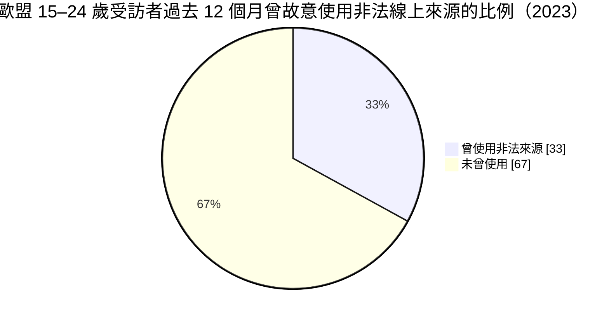

# 背景、構思、文獻與設計目標

> 本文件收錄原 README 第 2、3、4、5、14 節與附錄 A。章節編號沿用原目錄，方便與其他文件互相對照。

> 文件導覽：[中文 README](../README.zh.md) · [English README](../README.md) · [背景](01-background.md) · [架構與 API](02-architecture-and-api.md) · [測試](03-testing-and-evaluation.md) · [專案與課程](04-project-and-course.md) · [法律與附錄](05-legal-ethics-and-appendix.md) · [版本](06-version-history.md)

---

## 2. 背景與問題

### 2.1 本地情境：筆記作為可複製的數碼商品

在香港，補習筆記與自製教材在二手平台流通，並非新現象。賣家花費大量時間整理課堂內容、自製例題與溫習材料，再以付費形式出售；買家購入後，可以輕易將同一份 PDF 轉售、上載或分享。與實體書不同，數碼檔案的複製不會造成品質衰減，也幾乎沒有邊際成本，因此「二次販賣」對原作者的傷害特別直接。

這類交易還有一個結構性問題：買賣雙方往往只有一對一的通訊紀錄，檔案一旦離開賣家的裝置，便失去與買家之間的技術連結。當賣家在另一個平台發現自己的筆記被低價轉售，他可能認得內容，卻無法證明「這一份副本最初是交給誰」。沒有這個連結，平台檢舉與法律追究都缺少關鍵證據。

### 2.2 侵權與執法現況

香港海關的執法案例說明，補習筆記與教材並非邊緣地帶，而是實際的侵權商品類別。

**表 1：香港海關涉及補習／教材侵權的行動**

| 日期 | 案件 | 行動與檢獲 | 與本專案的關聯 |
|---|---|---|---|
| 2016-11-23/24 | 連鎖補習社分發侵權補習筆記 | 檢獲逾 50,000 頁侵權筆記、25 部電腦、1 部打印機、13 部影印機，估計市值約 HK\$580,000；14 人被捕 | 補習筆記本身是侵權高風險商品 |
| 2026-03-10/11 | 網上售賣盜版中小學教材 | 2 名女子（29 歲及 54 歲）被捕；賣家收取款項後，以即時通訊應用程式傳送電子檔案 | 數碼教材複製成本低、傳播快，事後追溯困難 |

2016 年一案涉及逾五萬頁補習筆記，檢獲物品估計市值約 HK\$580,000；2026 年一案則顯示，侵權教材已改以電子檔案經即時通訊交付。前者說明侵權規模可以很大，後者說明數碼交付令複製與散播更快、更難追蹤。根據《版權條例》，未經版權擁有人特許而銷售或為售賣用途管有侵權物品，最高可判監禁四年，並可就每件侵權物品罰款 HK\$50,000（Hong Kong Customs and Excise Department, 2016, 2026）。

### 2.3 問題規模的間接證據

如果侵權是普遍現象，為何賣家仍難以追究？其中一個原因是，買家與賣家之間的交易往往只有一對一的通訊紀錄；另一個原因是，年輕族群對數碼內容的取得與分享態度較為開放。

歐盟知識產權局（European Union Intellectual Property Office [EUIPO], 2023）在 2023 年 1 月 30 日至 2 月 15 日期間，以線上方式訪問了 25,824 名 15 歲以上的歐盟居民。結果顯示，14% 受訪者承認在過去 12 個月曾故意使用非法線上來源；在 15–24 歲組別，比例升至 33%，是歐盟平均的兩倍以上。

*資料來源：EUIPO（2023），第 48 頁；樣本為 25,824 名 15 歲以上歐盟居民，15–24 歲為其中一個子組別。*

同一調查亦顯示，年輕族群在多種未經授權行為上的比例都高於平均：

**表 2：歐盟平均與 15–24 歲組別的比較（過去 12 個月）**

| 行為 | 歐盟平均 | 15–24 歲 | 倍數 |
|---|---:|---:|---:|
| 故意使用非法線上來源 | 14% | 33% | 2.4× |
| 非法串流體育內容 | 12% | 27% | 2.3× |
| 使用非法串流裝置 | 11% | 25% | 2.3× |
| 上載受版權保護內容與他人分享 | 11% | 25% | 2.3× |

*資料來源：EUIPO（2023），第 13–15、48–52 頁。*

此外，39% 受訪者曾懷疑自己買到的商品是否正品，15–24 歲組別升至 52%；15% 受訪者表示曾在不知情下買到仿冒品，15–24 歲組別為 23%。另有 13% 受訪者承認曾故意購買仿冒品，15–24 歲組別為 26%（EUIPO, 2023）。這些數字與本專案的情境有相似之處：買家未必意識到自己正在購買或轉售侵權副本，而賣家則需要一種能在事後辨認來源的工具。

> **重要限制**：以上是歐盟數據，並非香港數據；它不能用來推斷香港的實際比例。本文引用它，是為了說明一個跨地區的模式：年輕、熟悉數碼工具的族群，同時也是未經授權分享行為的高風險群體。香港目前缺乏針對「筆記轉售」的代表性調查，這是本研究的一項限制，也是未來工作之一。

### 2.4 現有做法為何不足

- **可見浮水印**：只能阻嚇，移除成本低；買家可以裁剪、遮蓋、重新輸入或截圖後再排版。
- **PDF 密碼與 DRM**：限制開啟或列印，但截圖、拍照、OCR 後即失效；部署與維護成本高，對小型賣家不現實。
- **平台檢舉**：需要先有證據；平台處理需時；賣家難以取得買家身份，也難以證明外洩源頭。
- **法律途徑**：刑事門檻與舉證成本高；沒有技術線索，難以建立完整的證據鏈。
- **學術原型**：不少只處理單一媒體或單一方法，參數複雜，未針對教材文件的工作流程設計。

因此，我們需要的不是另一套 DRM，而是一個輕量、可組合、能在檔案離開賣家後仍保留追溯線索的模組。

---

## 3. 兩個構思與選擇

### 3.1 構思 A：HK Privacy Scrubber

第一個構思是 **HK Privacy Scrubber**：一個自動辨識並遮蔽香港常見個人資料的 Python 套件，支援香港電話號碼、電郵、香港身份證號碼，以及使用者自訂的敏感詞。用法是 `scrub(text)`，回傳已遮蔽的文字；目標使用者是律師、法律行政人員等需要將文件交給 AI 分析、但又不能外洩客戶資料的專業人士。

**優點**：問題真實、價值清晰、API 簡單、與香港場景高度相關。  
**限制**：市場局限於香港；法律與合規銷售週期長；正則表達式與格式變體需要長期維護；市場上已有通用的 PII 偵測與企業 DLP 工具；在課程專題中，難以用視覺化方式展示成效。

### 3.2 構思 B：TraceMark 數碼水印

第二個構思是 **TraceMark**：一個提供四種水印方法、另加一個生成模式的 Python 模組，讓賣家為每一位買家嵌入獨立識別碼，並在檔案外洩時以候選密鑰比對，輸出模式內證據分數。它針對的不是「阻止複製」，而是「事後知道是誰外洩」。

**優點**：受眾不限於香港；與知識產權、課程目標、AI 時代的內容溯源高度契合；五種模式提供豐富的技術與易於用影片作展示素材之用；可與交易紀錄結合，形成可理解的證據鏈。  
**限制**：技術範圍大；穩健性與不可見性存在取捨；文字方法屬機率性，不能當作絕對證據；需要謹慎處理私隱與誤判。

### 3.3 決策矩陣

**表 3：兩個構思的比較（團隊評分，1–5 分）**

| 準則 | 權重 | HK Privacy Scrubber | TraceMark | 說明 |
|---|---:|---:|---:|---|
| 受眾規模與影響力 | 25% | 2 | 5 | 水印可跨地區、跨媒介 |
| 與 CS1302A 課程目標契合 | 20% | 3 | 5 | 水印涉及演算法、檔案格式、測試與設計模式 |
| 技術可行性（3 學分、4 人） | 20% | 4 | 3 | 水印範圍較大，需分階段 |
| 差異化與創新 | 15% | 3 | 4 | 多模式整合與溯源流程 |
| 影片與演示效果 | 10% | 3 | 5 | 嵌入、提取、識別均可視覺化 |
| 法律與倫理風險 | 10% | 3 | 3 | 兩者皆需處理私隱與誤用 |
| **加權總分** | **100%** | **2.95** | **4.25** | 主觀評分，非實證數據 |

> 評分是團隊在文獻回顧與課堂討論後的內部判斷，不代表市場調查結果。權重反映我們對課程專題的重視程度：受眾與課程契合度較高，技術可行性與風險則用於避免過度樂觀。

### 3.4 決定

我們選擇 **TraceMark**。理由不只是分數較高，而是它更符合課程的三個目標：以程式解決真實問題（CILO 3）、以良好結構與設計模式組織程式（CILO 4）、以測試與文件證明品質（CILO 2）。HK Privacy Scrubber 並非沒有價值；它可作為未來方向，或在同一套「敏感資料處理」框架下與 TraceMark 互補。

課程講者 Dr. Chan 在影片中示範如何以視覺化方式呈現抽象概念，這啟發了我們以圖表、流程圖與實際 demo 來解釋水印原理；這也是我們選擇 TraceMark 的其中一個原因。

---

## 4. 文獻回顧

### 4.1 圖像水印：從脆弱到穩健

圖像水印的研究可追溯至 1990 年代。Van Schyndel 等人（1994）提出以最低有效位元（LSB）嵌入資料，示範了人眼難以察覺的數碼水印；Yeung 與 Mintzer（1997）則將水印用於圖像完整性驗證，強調「一旦圖像被改動，水印便會失效」的脆弱特性。LSB 提供大容量、低可見性的承載方式；Yeung 與 Mintzer 的脆弱驗證概念則提醒我們，提取成功不等於整幅載體完整。本專案的脆弱模式因此只用於隱藏資料與載荷驗證，不提供竄改定位。

如果說 LSB 是將訊號藏在最不明顯的地方，Cox 等人（1997）則反其道而行：將水印分散嵌入感知上重要的頻域係數，以換取對壓縮與處理的穩健性。Langelaar 等人（2000）的綜述整理了容量、不可見性與穩健性之間的取捨，說明三者難以同時最大化。

針對實際攻擊，Pramila 等人（2008）研究列印—掃描與 JPEG 壓縮下的資料隱藏；Ge 等人（2023）則以深度神經網絡處理螢幕拍攝文件的水印提取。這些工作說明：穩健水印不是單一演算法，而是嵌入、同步、錯誤更正與幾何校正的組合。

### 4.2 文字水印：零寬字元與同義詞

文字水印方面，零寬字元是最直接的方法。Kaushik 與 Bhardwaj（2021）指出，零寬字元可被用於隱藏惡意內容，顯示同一種技術既能保護內容，也能被濫用；Ishtiaq 等人（2025）則研究如何以零寬字元提升不可見性與訊息私隱。本專案採用類似原理，但明確限定用途與倫理邊界。

同義詞替換是另一條路線。Atallah 等人（2001）提出自然語言水印的設計與概念驗證；Lu 等人（2009）針對中文文本，以同義詞替換嵌入水印，並討論詞義消歧攻擊。這類方法將訊號藏於「用字選擇」，因此對複製貼上與部分重新輸入具有韌性，但對改寫、翻譯或統一用詞則不穩定。本專案目前的選詞模式只實作英文 tokenizer 與詞表；中文同義詞列為未來工作，因此不把 Lu 等人的中文結果直接當成已實作能力。

作者身份鑑定（Stamatatos, 2009）與生成式 AI 水印（Fernandez et al., 2023; Kirchenbauer et al., 2023）提供了另一個角度：文字風格、用詞選擇與模型解碼過程，都可以用來區分來源。Kirchenbauer 等人（2023）為語言模型輸出加入可偵測的統計水印；Fernandez 等人（2023）則把水印植根於潛空間擴散模型的解碼器，使生成圖像帶有可追溯的簽名。我們最初以為檢測工具以文字風格判斷來源是誰的結果必定準確；然而，Weber-Wulff 等人（2023）發現，市面上多款 AI 文字偵測工具的準確度有限，提醒我們不應把單一分數當作結論。同樣地，TraceMark 的識別分數應被視為「線索」，而非「判決」。

### 4.3 錯誤更正與品質評估

為對抗雜訊與局部破壞，本專案的穩健圖像模式使用卷積碼、重複訊號與 soft Viterbi 解碼；文字選詞模式使用 Reed–Solomon（1960）作錯誤更正。早期文件曾把 Reed–Solomon 寫成「v2 擴充」，與實際實作不符。圖像品質以 PSNR 與 SSIM 衡量（Wang et al., 2004），提取品質以位元錯誤率（BER）與正規化相關（NC）衡量。

### 4.4 標準與法規

在標準與法規層面，內容來源與真實性聯盟（Coalition for Content Provenance and Authenticity [C2PA], 2026）的 2.5 版規範定義了內容來源與編輯歷史的簽章格式，讓平台與工具能驗證「這份內容從哪裡來、經歷了什麼」。它與水印互補：C2PA 記錄在 metadata 中，容易被移除；而水印嵌入內容本身，則較難完全刪除，但容量與穩健性有限。

歐盟《人工智能法案》（Regulation (EU) 2024/1689）第 50 條第 2 款要求生成合成內容的 AI 系統提供者，自 2026 年 8 月 2 日起，確保輸出以機器可讀格式標記並可被偵測為 AI 生成或經操控（European Parliament & Council of the European Union, 2024）。TraceMark 不是一個供公眾使用的生成式 AI 系統；其生成模式只是在本機模型輸出加上統計水印，不宣稱符合該條款。但兩者面對的是同一個問題：如何在內容離開原始環境後，仍保留可驗證的來源線索。

### 4.5 研究缺口

綜合而言，文獻提供了成熟的單一方法，但較少討論如何將多種方法整合成一個面向非專家用戶的 Python 套件，並以教材文件為對象進行端到端評估。本專案的貢獻不在於發明新的水印演算法，而在於工程整合、介面設計、測試方法與香港本土的情境。

---

## 5. 設計目標與範圍

### 5.1 設計目標

**表 4：TraceMark v1 的設計目標**

| ID | 目標 | 對應指標 | 狀態 |
|---|---|---|---|
| G1 | 五種模式共用一致的 API | `embed` / `extract` / `identify` | 設計完成 |
| G2 | 圖像脆弱模式不可見且容量足夠 | PSNR ≥ 40 dB；SSIM ≥ 0.98；1024×1024 RGB 淨容量 393,195 bytes | 已實作；PSNR／SSIM 待量測 |
| G3 | 圖像穩健模式抵抗常見處理 | JPEG q=30／50、0.5× 縮放、7° 旋轉、部分裁切、截圖、模擬翻拍；BER 目標 ≤ 5% | 已納入測試；BER 待量測 |
| G4 | 零寬字元模式可隨複製貼上移動 | 64 bytes 載荷；新增 682 個不可見字元；複製貼上後可提取 | 已實作；單元測試通過 |
| G5 | 選詞模式可識別外洩版本 | 10 個候選密鑰中 top-1 ≥ 90%；7,000 words 樣本可藏 3 bytes | 樣本已測；top-1 待量測 |
| G6 | 識別誤判可控 | 閾值下 false positive < 1% | 待量測 |
| G7 | 程式品質 | 單元測試覆蓋率 ≥ 80%；型別註解與 docstring | 部分完成；coverage 未量測 |
| G8 | 可用性 | 雙語 README、範例、文件；CLI 待完成 | 部分完成 |

> 上述閾值是設計目標，用來定義「成功」的標準，不是已經測得的結果。正式數據會在實作完成後，以 [第 9 節](03-testing-and-evaluation.md) 的同一套腳本產生。

### 5.2 非目標

- **不是 DRM**：不阻止複製、不限制開啟或列印。
- **不是加密**：不保證檔案機密性；水印的密鑰提供存取控制與偽造門檻，不是絕對安全。
- **不是自動定罪工具**：識別分數是機率性線索，不能單獨作為法律結論。
- **不宣稱抵抗所有攻擊**：v1 聚焦 JPEG、縮放、裁切、旋轉、截圖與複製貼上；模擬翻拍已納入測試，真實翻拍、列印—掃描、改寫、翻譯列為延伸或非目標。
- **不處理影片與音訊**：v1 只支援圖像與文字。
- **不是 AI 生成內容偵測器**：不判斷文本是否由 AI 生成；生成模式是在模型生成時加水印，不是偵測器，也不涉及模型訓練。

### 5.3 使用者與情境

**主要使用者**：DSE 筆記賣家、補習導師、小型教材創作者。  
**次要使用者**：需要外洩追溯的律師、教育機構、內容創作者。

三個使用者故事：

1. 作為筆記賣家，我可以在交付前為每位買家嵌入獨立編號，以便日後追溯。
2. 作為買家，我不希望收到一份被暗中追蹤的檔案；賣家應在交易頁面說明副本含識別碼。
3. 作為調查者，我可以取得 match／none／ambiguous 的判斷與各候選的結果，但最終判斷仍需結合交易紀錄與人工覆核。

### 5.4 名稱與定位

**TraceMark** 由「trace」（追溯）與「mark」（標記）組成；中文名「溯印」對應「追溯」與「印記」。定位是**輕量、開源、Pythonic、可組合**的追溯工具，而不是企業級 DRM 平台。

---

## 14. 參考文獻

### 14.1 學術文獻

Atallah, M. J., Raskin, V., Crogan, M., Hempelmann, C. F., Kerschbaum, F., Mohamed, D., & Naik, S. (2001). Natural language watermarking: Design, analysis, and a proof-of-concept implementation. In *Information hiding* (LNCS 2137, pp. 185–200). Springer. https://doi.org/10.1007/3-540-45496-9_14

Cox, I. J., Kilian, J., Leighton, F. T., & Shamoon, T. (1997). Secure spread spectrum watermarking for multimedia. *IEEE Transactions on Image Processing, 6*(12), 1673–1687. https://doi.org/10.1109/83.650120

Fernandez, P., Couairon, G., Jégou, H., Douze, M., & Furon, T. (2023). The Stable Signature: Rooting watermarks in latent diffusion models. In *Proceedings of the IEEE/CVF International Conference on Computer Vision* (pp. 22409–22420). IEEE. https://doi.org/10.1109/ICCV51070.2023.02053

Ge, S., Fei, J., Xia, Z., Tong, Y., Weng, J., & Liu, J.-N. (2023). A screen-shooting resilient document image watermarking scheme using deep neural network. *IET Image Processing, 17*(2), 323–336. https://doi.org/10.1049/ipr2.12653

Ishtiaq, S., Ejaz, N., Hashmi, M. U., & Shah, S. I. H. (2025). Enhancing imperceptibility: Zero-width character-based text steganography for preserving message privacy. *Acta Informatica Pragensia, 14*(3), 445–459. https://doi.org/10.18267/j.aip.271

Kaushik, K., & Bhardwaj, A. (2021). Zero-width text steganography in cybercrime attacks. *Computer Fraud & Security, 2021*(12), 16–19. https://doi.org/10.1016/S1361-3723(21)00130-5

Kirchenbauer, J., Geiping, J., Wen, Y., Katz, J., Miers, I., & Goldstein, T. (2023). A watermark for large language models. In *Proceedings of the 40th International Conference on Machine Learning* (PMLR 202, pp. 17061–17084). PMLR. https://proceedings.mlr.press/v202/kirchenbauer23a.html

Langelaar, G. C., Setyawan, I., & Lagendijk, R. L. (2000). Watermarking digital image and video data. A state-of-the-art overview. *IEEE Signal Processing Magazine, 17*(5), 20–46. https://doi.org/10.1109/79.879337

Lu, H., Lin, J., Li, T., & Fang, D. (2009). An anti-attack watermarking based on synonym substitution for Chinese text. In *2009 Fifth International Conference on Information Assurance and Security* (pp. 356–359). IEEE. https://doi.org/10.1109/IAS.2009.66

Pramila, A., Keskinarkaus, A., & Seppänen, T. (2008). Multiple domain watermarking for print-scan and JPEG resilient data hiding. In *Digital watermarking* (LNCS 5041, pp. 279–293). Springer. https://doi.org/10.1007/978-3-540-92238-4_22

Reed, I. S., & Solomon, G. (1960). Polynomial codes over certain finite fields. *Journal of the Society for Industrial and Applied Mathematics, 8*(2), 300–304. https://doi.org/10.1137/0108018

Stamatatos, E. (2009). A survey of modern authorship attribution methods. *Journal of the American Society for Information Science and Technology, 60*(3), 538–556. https://doi.org/10.1002/asi.21001

van Schyndel, R. G., Tirkel, A. Z., & Osborne, C. F. (1994). A digital watermark. In *Proceedings of the 1st International Conference on Image Processing* (Vol. 2, pp. 86–90). IEEE. https://doi.org/10.1109/ICIP.1994.413536

Wang, Z., Bovik, A. C., Sheikh, H. R., & Simoncelli, E. P. (2004). Image quality assessment: From error visibility to structural similarity. *IEEE Transactions on Image Processing, 13*(4), 600–612. https://doi.org/10.1109/TIP.2003.819861

Weber-Wulff, D., Anohina-Naumeca, A., Bjelobaba, S., Foltýnek, T., Guerrero-Dib, J. G., Popoola, O., Šigut, P., & Waddington, L. (2023). Testing of detection tools for AI-generated text. *International Journal for Educational Integrity, 19*, Article 26. https://doi.org/10.1007/s40979-023-00146-z

Yeung, M. M., & Mintzer, F. (1997). An invisible watermarking technique for image verification. In *Proceedings of the International Conference on Image Processing* (Vol. 2, pp. 680–683). IEEE. https://doi.org/10.1109/ICIP.1997.638587

### 14.2 法規、標準與官方資料

City University of Hong Kong. (2026a). *CS1302A Introduction to computer programming* [Course catalogue]. https://www.cityu.edu.hk/catalogue/ug/current/course/CS1302A.htm

City University of Hong Kong. (2026b). *CS1302A project brief and rubric* [Moodle course page; login required]. https://dive.cs.cityu.edu.hk/cs1302a-eq/

Coalition for Content Provenance and Authenticity [C2PA]. (2026). *C2PA specifications* (Version 2.5). https://spec.c2pa.org/specifications/specifications/2.5/

Copyright Ordinance, Cap. 528, Laws of Hong Kong. https://www.elegislation.gov.hk/hk/cap528

European Parliament and Council of the European Union. (2024). Regulation (EU) 2024/1689 of the European Parliament and of the Council of 13 June 2024 laying down harmonised rules on artificial intelligence (Artificial Intelligence Act). *Official Journal of the European Union*, L 2024/1689, 12.7.2024. https://eur-lex.europa.eu/eli/reg/2024/1689/oj

European Union Intellectual Property Office. (2023). *European citizens and intellectual property: Perception, awareness and behaviour 2023*. https://doi.org/10.2814/87818

Hong Kong Customs and Excise Department. (2016, November 25). *Hong Kong Customs combats distribution of infringing tutorial notes* [Press release]. https://www.info.gov.hk/gia/general/201611/25/P2016112500317.htm

Hong Kong Customs and Excise Department. (2026, March 11). *香港海關打擊網上售賣盜版中小學教材* [Press release]. https://www.info.gov.hk/gia/general/202603/11/P2026031100549.htm

Personal Data (Privacy) Ordinance, Cap. 486, Laws of Hong Kong. https://www.elegislation.gov.hk/hk/cap486

---

## 附錄 A：名詞表

| 名詞 | 說明 |
|---|---|
| 水印（watermark） | 嵌入內容中的識別訊號，用於證明來源或追蹤外洩。 |
| 脆弱水印（fragile watermark） | 對任何改動敏感；本專案用於隱藏資料與載荷驗證，不提供竄改定位。 |
| 穩健水印（robust watermark） | 能抵抗壓縮、縮放、裁切等處理，用於追溯。 |
| LSB | 最低有效位元；改動像素值最低位，人眼難以察覺。 |
| DCT | 離散餘弦變換；文獻常用於頻域嵌入。本專案穩健模式改用亮度圖案，不使用 DCT。 |
| BER | 位元錯誤率；提取位元中錯誤的比例。 |
| PSNR／SSIM | 圖像品質指標；PSNR 以 dB 表示，SSIM 為 0–1。 |
| 零寬字元 | 不佔顯示寬度的 Unicode 字元，可承載資料。 |
| 同義詞替換 | 以同義詞的選擇承載資料；本專案目前只實作英文，中文列未來。 |
| 五種模式 | `image_fragile`、`image_robust`、`text_invisible`、`text_lexical`、`text_generative`；前四種是水印方法，最後一種是生成時水印。 |
| 識別（identification） | 以多個候選密鑰比對內容，找出最可能的來源。 |
| 載荷（payload） | 要嵌入的資料，例如買家編號；本專案以認證標籤驗證，不是 CRC。 |
| DRM | 數碼版權管理；限制存取與複製的技術。 |
| C2PA | 內容來源與真實性聯盟；定義內容憑證格式。 |
