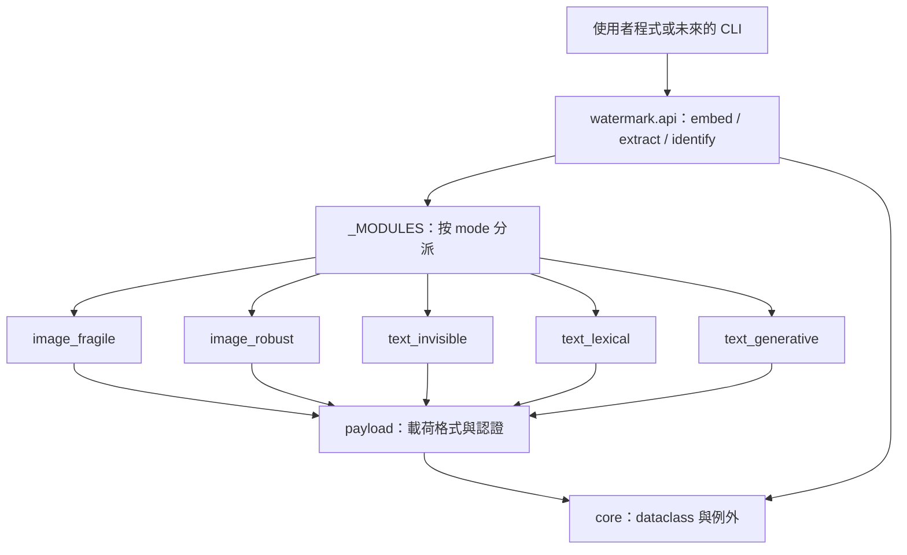
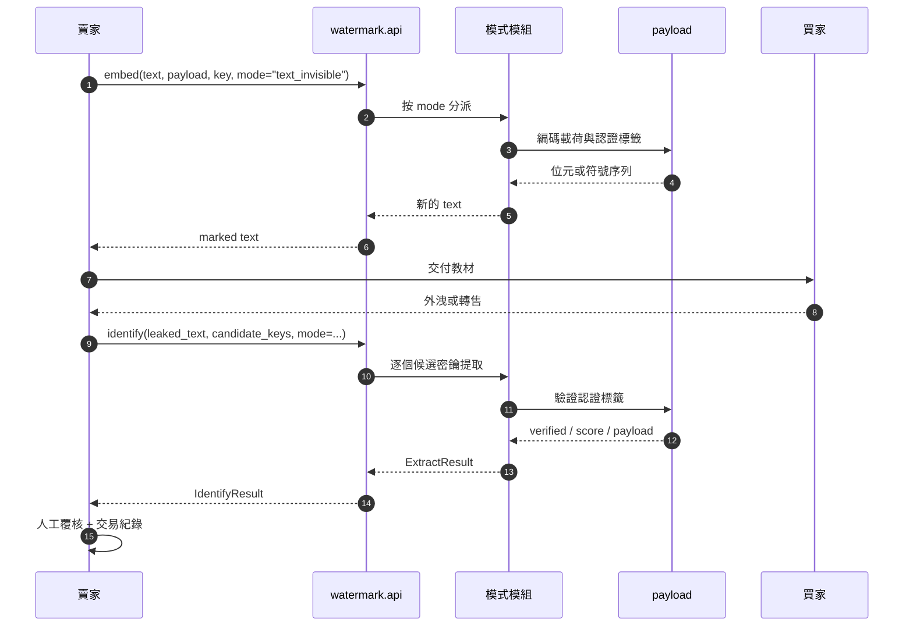

# 系統架構、公開 API 與未來工作

> 本文件收錄原 README 第 6、8、13 節，並依 2026-11-16 的實際實作更新。

> 文件導覽：[中文 README](../README.zh.md) · [English README](../README.md) · [背景](01-background.md) · [架構與 API](02-architecture-and-api.md) · [測試](03-testing-and-evaluation.md) · [專案與課程](04-project-and-course.md) · [法律與附錄](05-legal-ethics-and-appendix.md) · [版本](06-version-history.md)

---

## 6. 系統架構

### 6.1 分層架構

實際程式以 `watermark` 套件提供三個公開函式，透過 `_MODULES` 分派到五個模式模組。使用者程式只接觸 `watermark.api` 與 `watermark.core` 的結果型別；載荷編碼、密鑰派生與載體處理都在套件內完成。



### 6.2 資料流

API 只處理記憶體中的內容，不開檔、不存檔。下圖以文字為例；圖像的流程相同，只是 `content` 是 NumPy `uint8` 陣列。



### 6.3 設計與模組

- `watermark/api.py` 定義 `embed`、`extract`、`identify`，以 `_MODULES` 將 `mode` 字串映射到對應模組。新增模式時只需加入一個模組與一個映射，不需要修改公開簽名。
- `watermark/core.py` 放置 `ExtractResult`、`IdentifyResult` 等 dataclass，以及 `WatermarkError`、`CapacityError`、`UnsupportedModeError` 等例外。
- `watermark/payload.py` 負責兩種載荷格式、AES-SIV 認證加密、HMAC、scrypt／HKDF 密鑰派生與 profile 選擇。
- `watermark/image_fragile.py`、`image_robust.py`、`text_invisible.py`、`text_lexical.py`、`text_generative.py` 各自封裝演算法；模式之間不共享可變狀態。
- 這種「分派表 + 獨立模組」的結構取代了早期規劃的 `WatermarkMethod` 策略類別與 `MethodRegistry`。兩者可作為文件中的設計演進說明，但不是目前程式碼的介面。
- 早期規劃的 `metrics.py`、正式 CLI 與 `src/` 版面尚未實作；目前套件是頂層 `watermark/` 目錄。這些差異已在第 13 節列為未來工作。

### 6.4 目錄結構

```text
tracemark/
├── pyproject.toml
├── uv.lock
├── README.md                 # English default
├── README.zh.md              # 中文版
├── docs/
│   ├── 01-background.md
│   ├── 02-architecture-and-api.md
│   ├── 03-testing-and-evaluation.md
│   ├── 04-project-and-course.md
│   ├── 05-legal-ethics-and-appendix.md
│   └── 06-version-history.md
├── watermark/
│   ├── __init__.py
│   ├── api.py
│   ├── core.py
│   ├── payload.py
│   ├── image_fragile.py
│   ├── image_robust.py
│   ├── text_invisible.py
│   ├── text_lexical.py
│   ├── text_generative.py
│   └── data/
│       └── lexicon_v1.json
├── tests/
│   ├── conftest.py
│   ├── ocr_helper.py
│   ├── test_api.py
│   ├── test_payload.py
│   ├── test_image_fragile.py
│   ├── test_image_robust.py
│   ├── test_text_invisible.py
│   ├── test_text_lexical.py
│   ├── test_text_generative.py
│   └── data/
│       └── lexical_fixture.json
└── tools/
    ├── build_lexicon.py
    └── lexicon_v1_sources.json
```

`watermark/__init__.py` 只匯出公開函式與結果型別；`api.py` 不負責檔案 I/O。`docs/` 是文件，不是套件的一部分。

---

## 8. 公開 API

### 8.1 設計原則

- **做一件事**：API 不自行開檔、存檔或修改全域狀態；檔案輸出入由使用者控制。
- **明確型別**：公開函式有型別註解與 docstring；結果以 dataclass 回傳。
- **可測試**：模式模組、載荷編碼與密鑰派生可獨立測試；生成模式可注入 fake model。
- **可預期**：密鑰錯誤、容量不足、模式不支援時，拋出明確的例外，而不是靜默回傳 `None`。

### 8.2 函式簽名與輸入型別

```python
from watermark import embed, extract, identify

marked = embed(content, payload, key, *, mode, **options)
result = extract(content, key, *, mode, **options)
who = identify(content, keys, *, mode, **options)
```

| 參數 | 型別 | 說明 |
|---|---|---|
| `content` | 圖片：NumPy `uint8` 陣列；文字：`str` | 圖片可為 RGB／RGBA／灰階；API 回傳新物件，不改原輸入 |
| `payload` | `bytes` | 要藏的資料；`text_generative` 固定 `b''`；`image_robust`／`text_lexical` 可用 `b''` 表示 key-only |
| `key` | 非空 `bytes` 或 `str` | 字串密鑰會以 scrypt 派生；遺失密鑰無法還原載荷 |
| `keys` | `dict[str, bytes 或 str]` | `identify` 的候選標籤 → 密鑰 |
| `mode` | `str` | 必須明確指定；五個值見 8.3 |
| `**options` | 依模式而定 | 見 8.3；未知選項應拋出 `TypeError` 或 `ValueError` |

```python
from watermark import embed, extract, identify

text = "This is a set of teaching notes. " * 20
marked = embed(text, b"BUYER-001", "demo-key", mode="text_invisible")
result = extract(marked, "demo-key", mode="text_invisible")
print(result.verified, result.payload)

who = identify(marked, {"buyer-001": "demo-key"}, mode="text_invisible")
print(who.status, who.best)
```

### 8.3 模式與選項

| `mode` | 載體 | 必要資料 | 選項 | 預設 profile |
|---|---|---|---|---|
| `image_fragile` | 圖片陣列 | 非空 `payload` | `bits_per_channel=1` 或 `2`；`use_alpha=False` | `standard` |
| `image_robust` | 圖片陣列 | 短 `payload` 或 `b''` | `strength=1.0`、`markers=False`、`marker_strength=0.4` | `compact` |
| `text_invisible` | 文字 | 非空 `payload` | `copies=1` | `standard` |
| `text_lexical` | 英文文字 | `payload` 或 `b''`；`provider=` 或 `candidates=` 二選一 | 見 README 第 7.4 節；`return_details=False` | `compact` |
| `text_generative` | 生成提示 | `payload=b''`、`model=` | `max_tokens=400`、`temperature=0.8`、`top_k=64`、`seed=`；提取需 `tokenizer=` | 無載荷 frame |

補充：

- `image_robust` 的 key-only 模式要求 `markers=False`；`markers=True` 會加入八個 ArUco 標記，承載布局與容量不同。
- `text_lexical` 的 `candidates` 是 `Substitution(start, end, original, replacement)` 序列，從 `watermark.text_lexical` 匯入。`provider.propose(text)` 回傳候選；`DeepSeekProvider` 使用 `DEEPSEEK_API_KEY`，會將句子送到外部 API 並雙重審查。
- `text_generative` 的 `model` 需提供 tokenizer、`decode`、`prompt_ids`、`logits`、`eos_ids`；現成 `MLXModel` 針對 Apple silicon，第一次使用會下載模型。提取與識別必須使用相同 `tokenizer=`。

### 8.4 回傳值

```python
@dataclass(frozen=True)
class ExtractResult:
    mode: str
    verified: bool
    score: float
    payload: bytes | None
    details: dict

@dataclass(frozen=True)
class IdentifyResult:
    status: str                 # "match" | "none" | "ambiguous"
    best: str | None
    results: dict[str, ExtractResult]
```

- `ExtractResult.verified`：有載荷時，表示認證標籤通過；key-only／生成模式表示統計門檻通過。
- `ExtractResult.payload`：成功時為原始位元組；key-only 成功為 `b''`；失敗為 `None`。
- `ExtractResult.score`：模式內的品質／證據指標，不是「屬於某人的機率」。`image_fragile`／`text_invisible` 成功為 `1.0`；`text_lexical` 反映糾錯餘量；`image_robust` 反映解碼一致度；key-only／生成模式用統計證據。
- `ExtractResult.details`：診斷資訊，例如失敗原因、量測值或候選替換。
- `IdentifyResult.status`：`match` 表示恰好一個候選通過；`none` 表示全部失敗；`ambiguous` 表示多於一個通過。
- `IdentifyResult.best`：通過者中分數最高的標籤；全部失敗時為 `None`。
- `IdentifyResult.results`：候選標籤 → `ExtractResult` 的字典，保持呼叫者提供的順序，不是排序列表。

### 8.5 例外

```python
class WatermarkError(Exception): ...
class CapacityError(WatermarkError): ...
class UnsupportedModeError(WatermarkError): ...
```

不合法型別或參數可能拋出 `ValueError`／`TypeError`；容量不足使用 `CapacityError`；未知 `mode` 使用 `UnsupportedModeError`。呼叫者不應以捕捉 `Exception` 代替處理這些情況。

### 8.6 載荷格式與密鑰

| profile | 內容 | 總開銷 | 使用模式 |
|---|---|---:|---|
| `standard` | version（1 byte）+ length（4 bytes）+ AES-SIV 密文 + 16-byte tag | 21 bytes | `image_fragile`、`text_invisible` |
| `compact` | length（1 byte）+ 串流 XOR + 4-byte HMAC | 5 bytes | `image_robust`、`text_lexical` |

- 載荷本身有加密與認證；圖像或文字的整個載體沒有被加密。水印不是加密工具。
- 字串密鑰以 `scrypt` 派生主密鑰，再以 HKDF 派生各用途子密鑰；salt 與參數由實作管理，不屬於公開 API。
- 舊文件提到的 `derive_key(...)` 輔助函式尚未實作；目前由 `payload.py` 內部處理派生。不要在文件中把 `derive_key` 寫成已提供的公開 API。
- `image_fragile` 的 LSB 承載位置由密鑰派生排列；`text_invisible` 的密鑰保護載荷，插入位置本身不是由密鑰打亂。兩者的安全性假設不同，不能混為一談。

### 8.7 CLI

正式 CLI **尚未提供**。目前只有 Python API；`pyproject.toml` 沒有可用的 `tracemark` console script。舊版文件中的 `tracemark embed-image`／`tracemark identify` 是規劃，不是現況。

未來的 CLI 設計會遵守同一原則：不把密鑰放在命令列參數，改以檔案或環境變數提供；輸出必須同時顯示 `verified`、`score` 與失敗原因。

---

## 13. 未來工作

- **v1.1**：PDF 支援（文字層 + 渲染圖）、批次嵌入、完整金鑰管理、PyPI 發布後的安裝測試、JupyterHub 驗證。
- **v2**：以深度學習提升螢幕拍攝／翻拍穩健性（Ge et al., 2023）、影片與音訊水印、C2PA manifest 整合。
- **評估**：建立公開攻擊測試集；量測 coverage、PSNR／SSIM、BER 與 top-1；與賣家進行使用者研究；發表可重現的評估報告。
- **工程**：正式 CLI、`src/` 版面、CI、型別檢查、貢獻指南、倫理審查清單。
- **文件**：英文技術文件、API reference 自動生成、範例 notebook（`demo.ipynb`）。
