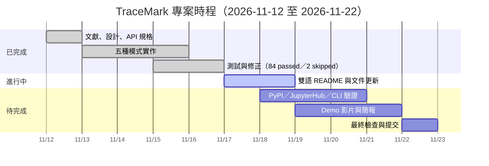
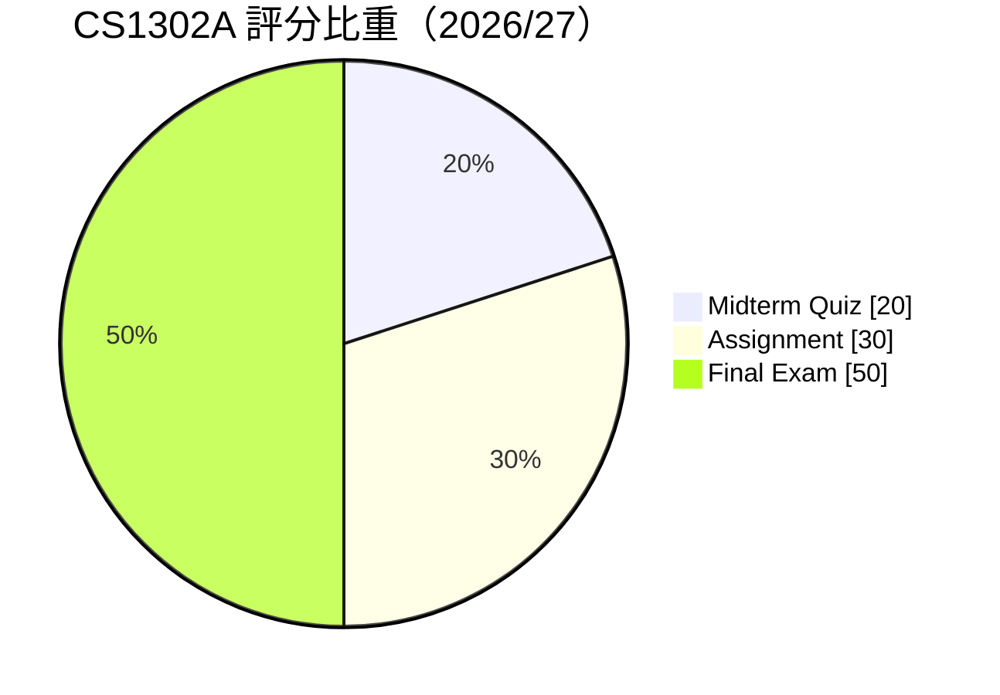

# 專案管理與課程對應

> 本文件收錄原 README 第 10、11 節。章節編號沿用原目錄；第 6–9 節的內容分散在 README、架構與測試文件中。

> 文件導覽：[中文 README](../README.zh.md) · [English README](../README.md) · [背景](01-background.md) · [架構與 API](02-architecture-and-api.md) · [測試](03-testing-and-evaluation.md) · [專案與課程](04-project-and-course.md) · [法律與附錄](05-legal-ethics-and-appendix.md) · [版本](06-version-history.md)

---

## 10. 專案管理

### 10.1 團隊分工

| 成員 | 姓名（學號） | 角色 | 主要職責 | 交付物 |
|---|---|---|---|---|
| Wing（Kit） | Wing Kit TSO（61204262） | Documentation Lead | 中文文件、`image_fragile` 實作與測試、英文 README 內容 | `README.zh.md`、`tracemark/image_fragile.py`、`tests/test_image_fragile.py` |
| Kay | Tung SUEN（61202650） | Documentation & English Lead | 英文翻譯與校對、`text_invisible` 實作與測試 | `README.md`、`tracemark/text_invisible.py`、`tests/test_text_invisible.py` |
| Billy | Bailin CHEN（61209510） | Lead Developer | 套件整合、其餘模式、工具、打包與發布、所有新增檔案 | `tracemark/`、其餘 `tests/`、`tools/`、`pyproject.toml`、`uv.lock`、`.gitignore`、`demo.ipynb`、`docs/` |
| Amos | Tsun Hei KAE（61201585） | Video Producer | API 測試、demo 影片 | `tests/test_api.py`、1 分鐘 demo 影片 |

> 課程規定每組 3–6 人；本組為 group85（4 人）。五種模式已實作；`0.1.0` 已在 PyPI 發布；目前焦點是 JupyterHub 驗證、demo 與提交。文件與程式同步進行，任何 API 或數據改動都要同步更新 `README.md`、`README.zh.md` 與 `docs/`。

### 10.2 時程（2026-11-12 至 2026-11-22）

> 官方專題截止時間為 2026-11-22 23:59。以下時程按實際進度更新：五種模式與本機測試已完成；11-17 起集中在雙語文件、發布驗證、demo 與提交。

### 10.3 里程碑

| 里程碑 | 目標日期 | 交付物 | 狀態 |
|---|---|---|---|
| M1：API 與發布基礎 | 2026-11-14 | API 規格、git repo、套件骨架 | 已完成 |
| M2：五種模式與本機測試 | 2026-11-16 | 五種模式、84 passed／2 skipped | 已完成 |
| M3：雙語文件與發布驗證 | 2026-11-19 | `README.md`、`README.zh.md`、`docs/`、PyPI 名稱與打包 | 進行中 |
| M4：提交 | 2026-11-22 23:59 | README、簡報頁、Moodle 提交 | 待完成 |
| M5：課堂簡報 | 最後一課（待公布） | 1 分鐘 demo + Q&A | 待完成 |

### 10.4 風險與緩解

| 風險 | 可能性 | 影響 | 緩解 |
|---|---|---|---|
| 穩健性不足 | 高 | 高 | 以攻擊矩陣界定適用範圍；文件中只報告已測案例；必要時把真實翻拍降為延伸目標 |
| 時程延誤 | 中 | 高 | 以 11-22 提交為硬期限；11-19 前完成雙語文件與打包；每日檢查 |
| 誤判／誤指控 | 中 | 高 | 分數加人工覆核；校準閾值；保留交易紀錄；文件明示 `score` 不是機率 |
| 法律與私隱 | 中 | 高 | 最小化資料；透明告知；PDPO 評估；`text_lexical` 外部 API 需揭露 |
| 平台移除零寬字元 | 高 | 中 | 失敗時回報原因；以圖像或選詞模式備援 |
| PyPI 名稱被佔用 | 中 | 高 | 先檢查 PyPI；準備備用名；`pyproject.toml` 的套件名是 `tracemark` |
| JupyterHub 依賴衝突 | 中 | 高 | 乾淨環境 `pip install .`；鎖定版本；提交前實測 |
| 英文版不同步 | 中 | 中 | 以 `README.zh.md` 為中文來源；Kay 校對英文；提交前逐節對照 |
| 測試覆蓋率未量測 | 高 | 中 | 出 `pytest-cov` 報告；未量測前不宣稱 80% |

### 10.5 協作方式

- Git 分支：`main` 保持可展示；功能在 `feat/*` 開發；文件在 `docs/*`。
- Pull request：至少一位組員審閱；程式改動需附測試。
- Commit 訊息：`feat:`, `fix:`, `docs:`, `test:` 前綴。
- Commit 節奏：每位成員至少每兩天有可見 commit；避免最後一天一次性推送，以符合「regular commit history」。
- 文件同步：`README.md`、`README.zh.md` 與 `docs/` 是公開文件；API 改動必須同步更新 [第 8 節](02-architecture-and-api.md)。
- 簡報分工：Wing 與 Kay 說明文件、動機與創新點；Billy 操作 demo 與回答實作問題；Amos 負責影片與視覺；Q&A 由全員分擔。

---

## 11. 課程對應（CS1302A）

### 11.1 課程資訊

CS1302A Introduction to Computer Programming 為 3 學分課程，使用 Python，2026/27 Semester A 開設。課程的學習成果（CILO）與評分比重如下（City University of Hong Kong, 2026a, 2026b）：

**表 9：CILO 與 TraceMark 的對應**

| CILO | 權重 | 官方描述 | TraceMark 的對應證據 |
|---|---:|---|---|
| 1 | 10% | Explain the structure of a computer program.（解釋程式結構） | 第 6 節 `api.py` → `_MODULES` → 五個模式模組的分層、資料流與目錄樹 |
| 2 | 20% | Analyze, test and debug computer programs.（分析、測試與除錯） | 2026-11-16 pytest：84 passed、2 skipped；測試涵蓋 API、載荷、五種模式與 OCR 樣本 |
| 3 | 50% | Apply proper programming techniques to solve a task.（應用程式技巧解決任務） | 第 2 節真實案例；第 7–8 節五種模式與 `embed`／`extract`／`identify` API |
| 4 | 20% | Construct well-structured programs.（建構良好結構的程式） | `api.py` 分派表、`core.py` dataclass／例外、`payload.py` 認證格式、模式模組獨立 |

**表 10：Assignment 30% 的組成（佔課程總分）**

| 項目 | 佔課程總分 | 說明 |
|---|---:|---|
| E-Quizzes | 20% | 課後作業 |
| CE-Quizzes | 5% | 課堂練習 |
| Group Project | 5% | 本專案 |
| 合計 | 30% | 與 Midterm Quiz 20%、Final Exam 50% 合計 100% |

> 注意：表中的百分比均以課程總分計算；E-Quizzes 20% + CE-Quizzes 5% + Group Project 5% = Assignment 30%。

### 11.2 本文件集如何回應課程要求

- **CILO 1（10%）— Explain the structure of a computer program.**：第 6 節說明 `api.py`、`_MODULES`、五個模式模組與 `core.py` 的邊界，讓讀者理解程式結構，而不只是看單一函式。
- **CILO 2（20%）— Analyze, test and debug computer programs.**：第 9 節列出已測項目、實際 pytest 結果與尚未量測的指標；程式碼使用型別註解、docstring 與明確例外。
- **CILO 3（50%）— Apply proper programming techniques to solve a task.**：第 2 節以真實執法案例說明問題；第 7–8 節把五種模式落到可呼叫的 `embed`／`extract`／`identify` API；JupyterHub 安裝仍待驗證。
- **CILO 4（20%）— Construct well-structured programs.**：第 6.3 節以分派表、dataclass、例外階層與獨立模式模組示範結構；早期規劃的 Strategy／Registry 已由實際設計取代。

### 11.3 GenAI 使用規定

課程的 Midterm Quiz 佔 20%，不允許使用 GenAI；Assignment 佔 30%，允許使用 GenAI；Final Exam 佔 50%。Assignment 30% 由 E-Quizzes 20%、CE-Quizzes 5% 與 Group Project 5% 組成（均以課程總分計）。本文件集屬 Group Project 的文件交付物，依課程規定可使用 GenAI 輔助。所有引用、數據與事實均由團隊成員逐項核對；詳細聲明見 [附錄 B](05-legal-ethics-and-appendix.md)。

### 11.4 官方專題要求與評分準則

課程專題的截止時間為 2026-11-22（星期日）23:59；每組 3–6 人，本組為 group85（4 人）。官方要求與評分準則如下（City University of Hong Kong, 2026b）：

**表 11：官方專題要求與 TraceMark 的對應**

| 準則 | 官方要求 | TraceMark 的對應 | 目前狀態 |
|---|---|---|---|
| published | 公開 PyPI 套件頁與 public git repo；套件已上載並版本化 | `tracemark` 套件、`pyproject.toml`、GitHub repo `barebone-lab/tracemark`、`0.1.0` | 已完成：`0.1.0` 已在 [PyPI](https://pypi.org/project/tracemark/) 發布，首頁連到公開 repo |
| documented | 公開文件：動機、創新、使用案例、安裝與使用指南 | 雙語 README 與 `docs/` | 已完成：中英文 README 結構一致，並已推上 GitHub |
| functional | 在 JupyterHub 以 `pip install` 安裝無衝突，並在簡報中示範 | Python API、pytest、JupyterHub 安裝測試 | 本機測試通過；JupyterHub 待驗證 |
| innovative | 可重用、不易被現有套件取代的功能 | 五種模式共用 API、`identify` 的 match／none／ambiguous | 已實作；README「Why not existing tools」一節列出與現有套件的比較 |
| teamwork | 定期 commit history 與不同成員聯合簡報 | 四人分工、Git 流程、1 分鐘 demo | 進行中 |

每項準則為 0/1 分，合計 5 分。`published` 與 `documented` 已完成；`functional`（JupyterHub 安裝）是目前最需要優先補齊的一項。

### 11.5 提交與簡報

- **截止**：2026-11-22（星期日）23:59，於 Moodle「Project」頁面按「Make a submission」繳交。
- **簡報**：最後一課 1 分鐘 demo，隨後的短 Q&A；由不同成員分工回答。
- **Presentation Page**：在 Moodle wiki 的 group85 頁面放入 README、PyPI、repo、demo 影片與簡報；所有連結需在講室電腦預先測試；此頁在截止後會公開給全班，需保持專業。
- **文件與程式同步**：README 是入口，`docs/` 是詳細文件；提交前確認 PyPI 首頁指向 git repo。

